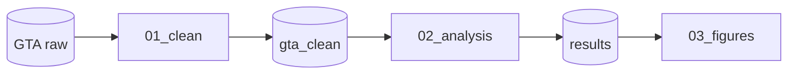

# pipeline-graph

Entender o pipeline como DAG: nós são scripts e dados (arquivos/tabelas);
arestas são consumo/produção.

## Método (pragmático, sem parser universal)

NÃO tentar parsear SQL/R/Python perfeitamente. Usar:

1. **Busca textual** por chamadas de leitura/escrita:
   - R: `read_csv`, `fread`, `readRDS`, `read_sf`, `dbGetQuery`, `source` /
     `write_csv`, `saveRDS`, `ggsave`, `dbWriteTable`, `st_write`
   - Python: `read_csv`, `read_parquet`, `read_sql`, `open` /
     `to_csv`, `to_parquet`, `to_sql`, `savefig`
   - SQL: `CREATE TABLE`, `INSERT INTO`, comentários `-- consumes` /
     `-- produces`
2. **Nomes de arquivos e tabelas** como chaves de ligação entre scripts.
3. **Contexto** do usuário e do AGENTS.md (numeração de etapas indica ordem,
   mas não é fonte de verdade).

## Formato do mapeamento

```
01_clean.R
├── consome → input/raw/gta.csv
└── produz  → intermediate/gta_clean.parquet
                    ↓
02_analysis.R
├── consome → intermediate/gta_clean.parquet
└── produz  → output/tables/results.csv
```

## Mermaid (quando ajudar a visualizar)



## Verificações

- Referenciado mas nunca produzido: upstream faltante (etapa quebrada ou não
  commitada).
- Produzido mas nunca consumido: output órfão — confirmar com o usuário
  antes de sugerir remoção.
- Ciclos: pipeline analítico não deveria ter.
- Após mudança de nome/path/schema: listar consumidores afetados e checar
  compatibilidade (usar junto com data-pipeline).
