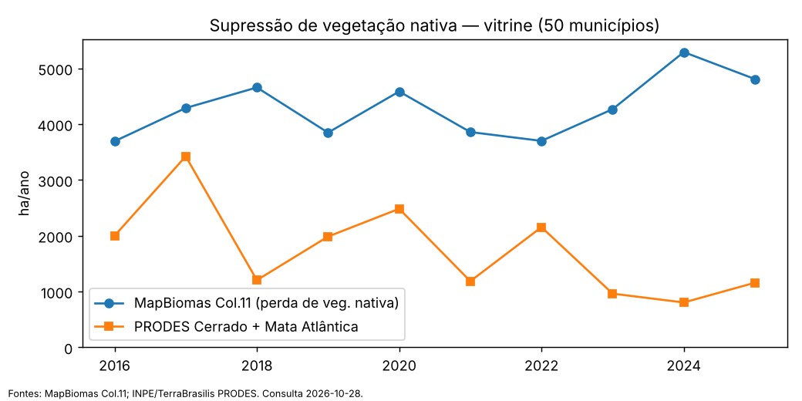
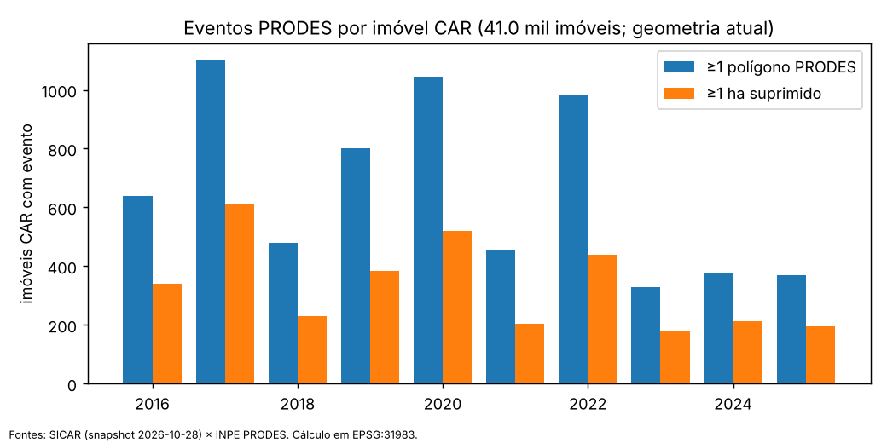

# 01 — Diagnóstico territorial: RMBH + Colar Metropolitano + Sete Lagoas

- Sessão: 01 · Data das consultas: 2026-10-28 · Escopo: pesquisa (scripts de consulta em `scripts/01-diagnostico-territorial/`, sem dados versionados)
- Fontes dos números: consultas diretas a bases públicas (Parte B) e literatura (Parte C). **Números de literatura vieram de resumos de busca e estão marcados como "não verificado no primário".**

## 1. Resumo executivo

1. **A vitrine tem 50 municípios** (34 RMBH + 16 Colar; Sete Lagoas é do Colar): 5,73 milhões de habitantes, 14.979 km², PIB 2023 de R$ 331 bi. O agro é **pequeno em valor** (VAB agropecuário 2021 = R$ 1,01 bi, 0,34% do PIB de 2021 da vitrine; ≈0,31% sobre o PIB 2023), mas relevante em dezenas de municípios pequenos (>15% do PIB local em vários) e **ocupa muita terra**: 555 mil ha de pastagem e 643 mil ha de vegetação nativa (42,9%) (MapBiomas Col. 11, 2025).
2. **Há eventos em número moderado para um Y de supressão de vegetação, e só em nível de imóvel (município é quase sempre positivo)**: 3.693–5.291 ha/ano de perda de vegetação nativa (MapBiomas, 2016–2025) e 804–3.423 ha/ano no PRODES. Em 2016–2025, **328 a 1.102 imóveis CAR por ano (0,8%–2,7%) tiveram ≥1 polígono PRODES**; 5.029 imóveis distintos na década (12,3%); 178–611 por ano com ≥1 ha suprimido. Isso permite um backtest exploratório na vitrine, **não prova poder** (§6). **Achado crítico: as duas fontes de supressão têm correlação anual de −0,37 (2016–2025)** — o rótulo ainda não é estável (§11).
3. **Embargo/autuação federal é raro demais** na vitrine: 174 embargos e 1.377 autos IBAMA em 2016–2026 (165 embargos em 2016–2025, ≈17/ano; só 17,6% dos município-anos têm embargo). Embargo estadual só existe para 2025–2026 na IDE-Sisema. Serve como Y de consequência apenas com recorte ampliado de MG.
4. **Pressões com evidência nos dados**: de 2015 a 2025 a vegetação nativa caiu 31.507 ha (líquido), enquanto o urbano cresceu 11.277 ha e a mineração 9.647 ha (juntos, 66% da perda líquida). A pastagem caiu 12.557 ha (líquido). A mineração cresce sobretudo em Itabirito, Nova Lima, Barão de Cocais e Brumadinho; o urbano, em Betim, Sete Lagoas, Lagoa Santa e Contagem; o carste (Matozinhos, Lagoa Santa, Pedro Leopoldo, Confins) é o hotspot de sobreposição CAR × APA.
5. **Maior risco metodológico encontrado**: o SICAR público só entrega o **snapshot atual** (geometria vigente, sem versões). Um backtest 2016–2025 sobre essa geometria vaza informação (retificações, criação posterior ao evento). É preciso snapshot datado ou assumir a limitação por escrito (§6).
6. **Recomendação de Y para a sessão 06** (§7): (A) supressão de vegetação nativa ≥1 ha por imóvel em 12–24 meses (PRODES como rótulo, MapBiomas como cobertura complementar) — **~180–610 imóveis positivos/ano**; (B) o mesmo evento **sem autorização do IEF** (Y de maior valor para o crédito, mas depende de validar o cruzamento com autorizações); (C) embargo/autuação como Y de segunda etapa, **só com recorte ampliado**.
7. **Lacunas a fechar**: token MapBiomas Alerta, snapshot datado do CAR, autos de infração SEMAD/IEF (só painel Power BI; via LAI), licenças formais de SICAR/IBGE/BDQueimadas/IDE-Sisema (ficam para a sessão 02), datas de publicação do PRODES.

## 2. Estrutura do documento

- **Parte A** (§3–§7): leitura analítica — pressões, poder estatístico, riscos, recomendação de Y, oportunidades, perguntas em aberto.
- **Parte B**: tabelas por município e metodologia de obtenção (composição territorial, MapBiomas, candidatos a Y, CAR, defasagens, tentativas).
- **Parte C**: literatura sobre a região (pressões, hídrico, autos).
- **Fontes usadas**: ao final.

# Parte A — Análise

## 3. Pressões típicas: o que os dados mostram e o que a literatura diz

| Pressão | Evidência nos dados (Parte B) | Evidência na literatura (Parte C) | Confiança |
|---|---|---|---|
| Expansão urbana/loteamentos | Urbano +11.277 ha em 2015–2025 (MapBiomas Col. 11). Maiores ganhos: Betim (+865), Sete Lagoas (+686), Lagoa Santa (+642), Contagem (+558), Esmeraldas (+556), Jaboticatubas (+514), Itabirito (+497). | Loteamentos irregulares no Vetor Norte/BR-040 e indução estatal (Linha Verde, condomínios); estudos de 2007–2014, sem série quantitativa recente (C.a). | Média (dados fortes, literatura antiga) |
| Mineração / barragens | Mineração +9.647 ha em 2015–2025 (28.154 ha em 2025). Maiores: Itabirito (+1.843), Nova Lima (+1.319), Barão de Cocais (+1.062), Brumadinho (+855), São Gonçalo do Rio Abaixo (+650), Santa Bárbara (+634). | ANM: barragens em níveis de emergência no QF (2025); expansão de 213% da área minerada 1985–2011 (C.b). | Alta |
| Eucalipto | Silvicultura 36.855 ha em 2025 (estável: −368 ha desde 2015); concentrada em Santa Bárbara (7.990), Caeté (6.740), São Gonçalo do Rio Abaixo (4.771), Barão de Cocais (3.698). | MapBiomas pode **subestimar** eucalipto (estudo do semiárido, não da RMBH) (C.c). | Média |
| Pecuária/pastagem | 555.495 ha de pasto (37% da área); 484.614 bovinos (2024); pasto caiu 12.557 ha líquidos desde 2015. | Sem dados regionais atuais de pastagem (C.c). | Média |
| Cinturão verde (hortaliças) | **Dado não sustenta o cinturão hoje**: Igarapé (VAB agro R$ 88 mi) e São Joaquim de Bicas (R$ 47 mi) têm PAM 2023 de só R$ 5,1 mi e R$ 3,1 mi, logo o valor agro ali vem de outras atividades (pecuária/avicultura/suinocultura — não verificado), não de lavoura. Lavoura total (PAM 2023): R$ 410 mi na vitrine. | Polo Igarapé/São Joaquim de Bicas/Ibirité/Sarzedo/Mário Campos fornece à CEASA/MG (dado de 2013) (C.c). | Baixa (dado atual de hortaliças não obtido) |
| Carste (Lagoa Santa/Sete Lagoas) | 3.914 cavidades CANIE na vitrine (Matozinhos 833, Prudente de Morais 482, Barão de Cocais 356, Santa Bárbara 311, Sete Lagoas 305); 781 imóveis CAR tocam a APA Carste (Matozinhos 258, Lagoa Santa 208, Pedro Leopoldo 144, Confins 122). | APA Carste (zoneamento espeleológico: mineração = impacto forte sobre cavernas); pressões de loteamento, turismo e polos industriais de Confins (C.d). | Média |
| Escassez hídrica / outorga | 5.698 outorgas com data na vitrine (publicação concentrada em 2019–2022); **só 2 áreas de conflito hídrico declaradas** (Ribeirão Ribeiro Bonito e Ribeirão Paciência). | Crise 2014–15 (Serra Azul); rompimento em 2019 paralisou a captação no Rio Manso e a outorga emergencial de 5.000 l/s no Paraopeba foi dada com parecer de indisponibilidade (C.e). | Média (conflito formal é estático e raro) |

**Para onde foi a vegetação nativa?** A coleção usada não traz matriz de transição por município, e a tabela de desmatamento não informa o destino. Só é possível dizer (variação líquida de estoque, 2015→2025): nativa −31.507 ha; urbano +11.277; mineração +9.647; agricultura +2.663; pastagem −12.557; silvicultura −368. Isso **não identifica a transição** (parte da perda "bruta" de 3,7–5,3 kha/ano é vegetação secundária suprimida de novo; a divisão primária/secundária por município está na Tabela 3). Fica como pergunta em aberto (matriz de transição pixel a pixel).

## 4. Candidatos a Y — eventos por ano na vitrine

Tabela com totais anuais na vitrine (Parte B §B.3.1) e conversão para imóvel quando possível.

| Candidato | Observado na vitrine (por ano) | Taxa de município-anos positivos | Em nível de imóvel CAR | Defasagem / publicação | Veredicto |
|---|---|---|---|---|---|
| Supressão de veg. nativa — PRODES (Cerrado + MA) | 804–3.423 ha | 86% (≥1 ha) | **328–1.102 imóveis/ano (0,8%–2,7%)**; 178–611 com ≥1 ha (calculado nesta sessão com a geometria atual do CAR) | PRODES: data de publicação não verificada (campo uniforme) | **Candidato forte** |
| Supressão — MapBiomas Col. 11 (perda de veg. nativa) | 3.693–5.291 ha | 99,6% | não calculado (raster não baixado) | ~8–10 meses; série inteira reprocessada a cada coleção | Complementar (ruído de secundária) |
| MapBiomas Alerta | metadados: 1.159 alertas na última publicação (2026-10-20) | — | — (API exige token) | semanal | Não avaliado (token) |
| Fogo (MapBiomas Fogo; focos INPE) | 5.947–32.470 ha; 96–935 focos | 98% (área) / 89% (focos) | não calculado (focos ≤ 935/ano → ≤2,3% dos imóveis, limite superior) | focos: quase imediato; Fogo: ~6–7 meses | Alto volume; valor econômico duvidoso (queima agrícola/natural) |
| Embargo IBAMA | 0–55 embargos/ano (165 em 2016–2025; 174 até 2026) | 17,6% | ≤ 55 imóveis/ano (limite superior) | data do ato ≠ data de inclusão | **Raro demais** na vitrine |
| Autos IBAMA — Flora | 4–100 | 16,8% | ≤ 100/ano | idem | Raro |
| Embargo estadual (IDE-Sisema) | 372 polígonos (2025–2026) | — | só 2 anos, sem histórico | snapshot | Inutilizável para treino hoje |
| Autorização de supressão IEF | 191 (2021–2026), 24–433 ha/ano | — | ~40 autorizações/ano | snapshot | **Mediador legal** (supressão autorizada), não Y |
| Fiscalizações SISFIS (todas) | 965–7.443 | 99,4% | — | snapshot; legado migrado | **Proxy de esforço**, não de ocorrência (Flora: 37 em 2015 → 1.402 em 2023) |
| Conflito hídrico (DAC) | 2 áreas declaradas | — | estático | — | Atributo, não Y |

Pontos de atenção:
- PRODES e MapBiomas **divergem em escala** (ver Perguntas em aberto). Na literatura, os números de MG para a Mata Atlântica divergem também entre Atlas SOS/INPE (2.737 ha em 2023–24), alertas do IEF (7.451 ha em 2024) e MapBiomas (5.352 ha em 2024) — **não verificado no primário** (C.f). A definição do rótulo é um risco do produto, não detalhe técnico.
- A série SISFIS cresce com o esforço de registro; usá-la como Y ensina o modelo a prever onde se fiscaliza.

## 5. Número de imóveis no CAR e sobreposição com UCs

(Tabelas 9 e 10 na Parte B.) Principais números, SICAR em 2026-10-28:

- **40.997 imóveis** ativos/pendentes/suspensos (+391 cancelados), somando **1,19 milhão de ha** (79% da área da vitrine; >100% em Barão de Cocais, Prudente de Morais, São José da Varginha e São José da Lapa: sobreposição).
- Distribuição: **67,7% são ≤1 módulo fiscal** (27.741); 22,0% de 1 a 4 MF (9.013); 8,1% de 4 a 15 MF (3.302); 2,3% >15 MF (941). Só **21,8% foram analisados**. O alvo "pequenos e médios produtores" (decisão 0001) corresponde a ≤15 MF, ~98% dos imóveis (≤4 MF: 89,7%).
- Municípios com mais imóveis: Esmeraldas 2.570, Bonfim 2.395, Jaboticatubas 2.371, Itaúna 2.313, Pará de Minas 2.114, Itaguara 2.014.
- UC: **781 imóveis** tocam a APA Carste de Lagoa Santa (31.418 ha), **1.893** a APA Sul RMBH (127.589 ha), **5.141** alguma UC (209.957 ha). Verificação da camada federal contra o CNUC: não verificado.

## 6. Poder estatístico e recorte de treino

**O que foi calculado nesta sessão:** número de imóveis CAR (geometria atual, 40.997 imóveis) com ≥1 polígono PRODES por ano (`scripts/.../s08_poder_imovel.py`).

| Ano | Imóveis com PRODES | % dos imóveis | ≥0,5 ha | ≥1 ha |
|---|---|---|---|---|
| 2016 | 639 | 1,56 | 401 | 339 |
| 2017 | 1.102 | 2,69 | 732 | 611 |
| 2018 | 481 | 1,17 | 287 | 230 |
| 2019 | 800 | 1,95 | 470 | 384 |
| 2020 | 1.046 | 2,55 | 628 | 521 |
| 2021 | 453 | 1,10 | 244 | 205 |
| 2022 | 983 | 2,40 | 540 | 438 |
| 2023 | 328 | 0,80 | 214 | 178 |
| 2024 | 377 | 0,92 | 245 | 212 |
| 2025 | 369 | 0,90 | 235 | 196 |

Fonte: SICAR (WFS, 2026-10-28) × INPE PRODES (TerraBrasilis, 2026-10-28); cálculo em EPSG:31983. Há tendência de queda a partir de 2023 (2021–2025: 328–983).

**Leitura (estimativas minhas, não medições):**
- Com cortes anuais (2018–2023) e janela de 12 meses, o backtest dispõe de ~330–1.100 imóveis com qualquer polígono PRODES por corte (4.091 no total em 2018–2023) e, para o Y-A (≥1 ha), ~180–520 por corte (**1.956 no total**). Contagens por imóvel, sem deduplicar polígonos em áreas de CARs sobrepostos. Para precision@k em top 1% (k≈410) e precisão verdadeira de 20%, o erro-padrão binomial é ≈2 pontos percentuais (sem corrigir autocorrelação espacial, que aumenta a incerteza).
- Com prevalência de 0,8%–2,7% por ano, **lift** e **recall no top 5–10%** são viáveis; calibração fina por faixa, **não** (poucos positivos por decil).
- O número de eventos depende de a geometria do CAR ser a vigente na data do evento. Com a geometria atual: (i) imóveis criados/retificados depois do evento podem receber o evento no passado; (ii) o CAR 2016 teve pico de cadastros (8.194 de 40.997), então o painel é desbalanceado no tempo. **Esses números são limite superior da qualidade do rótulo, não prova de poder.**
- Y composto "sem autorização": autorizações IEF são ~38/ano (24–433 ha/ano) frente a 800–3.400 ha/ano de PRODES; a maior parte da supressão mapeada não cruza com autorização do IEF, mas **o cruzamento por imóvel não foi feito** e outras formas de autorização/isenção podem existir (não verificado).
- **Embargo/autuação:** ≤55 eventos/ano federal; estadual sem histórico. Insuficiente na vitrine. Para ter centenas de eventos por ano seria preciso MG inteiro (IBAMA: 545 embargos só em 2022 em MG, segundo a base aberta) e dados do estado (LAI).

**Recorte ampliado sugerido** (não quantificado nesta sessão; próximo passo: repetir `s03/s04/s08` para os municípios):
1. **Vitrine (50 municípios)** como recorte principal para Y-A: ~180–610 imóveis/ano ≥1 ha.
2. Para validar fora de amostra espacial e estimar efeitos por classe de tamanho, acrescentar a **mesorregião Metropolitana de BH** completa e a **Central Mineira** (Sete Lagoas já está nela).
3. Para Y-C (embargo), **todo o Cerrado mineiro** + dados SEMAD/IEF por LAI.

## 7. Recomendação de Y (insumo da sessão 06)

| # | Y candidato | Eventos/ano na vitrine | Por que | Riscos |
|---|---|---|---|---|
| A | **Supressão de vegetação nativa ≥1 ha por imóvel em 12–24 meses** (rótulo PRODES; MapBiomas Alerta quando houver token) | ~180–610 imóveis/ano (calculado) | Evento frequente, observável por satélite, sem depender de ato administrativo; base do backtest | PRODES com mínimo mapeável maior; CAR sem versões; secundária vs. primária |
| B | **Supressão sem autorização** (A menos área autorizada IEF) | ≤ A; fração não medida | Maior valor ao comprador: ilegalidade é o que gera restrição de crédito/embargo | Cruzamento com autorizações não feito; autorização em outras bases; menor n |
| C | **Embargo/autuação (IBAMA + SEMAD/IEF)** como evento de segunda etapa | ≤55 (IBAMA) na vitrine; estadual sem histórico | Liga diretamente a perda econômica ao crédito | Insuficiente na vitrine; vieses de fiscalização |

Não recomendo, por ora, fogo como Y principal (muito frequente, ambíguo para o comprador) nem conflito hídrico (2 áreas declaradas). Decisão final é da sessão 06.

## 8. Oportunidades de inovação para o AgroRisk

Cada item: evidência, fonte, por que os concorrentes não fazem (**hipótese não verificada, a testar com `analista-mercado` na sessão 03**), esforço (P/M/G).

1. **Base estadual IDE-Sisema como camada própria** — WFS aberto com 1.420 camadas: histórico de fiscalizações 2013–2025 (37.502 pontos na vitrine), autorizações de supressão IEF (191), outorgas (5.698), cavidades CANIE (3.914), conflito hídrico. Fonte: `https://geoserver.meioambiente.mg.gov.br/wfs` (consulta 2026-10-28). Concorrentes de "consulta de CAR" tendem a usar bases federais (hipótese). Esforço: M. Pré-requisito: licença de reuso não verificada.
2. **Prescrição por sobreposição CAR × UC/APA/carste** — 5.141 imóveis cruzam UCs; 781 a APA Carste; 3.914 cavidades. Fonte: Parte B §4. Esforço: P–M.
3. **Backtest com snapshots datados e declaração de vazamento temporal** — o CAR público não tem versões; o MapBiomas reprocessa a série a cada coleção. Quem declara e controla isso tem argumento de credibilidade com um comprador cético. Fonte: Parte B §4 e §5. Esforço: G (depende de obter snapshots).
4. **Rótulo auditável (ilegal × legal)** — separar supressão autorizada da não autorizada. Evidência: autorizações IEF ~38/ano vs. milhares de ha/ano PRODES; MapBiomas Alerta tem filtros de CAR/embargo/autorização (metadados da API). Esforço: M.
5. **Indicador de risco hídrico/outorga para carteira de crédito rural em Paraopeba/Velhas** — evidência qualitativa (C.e: outorga de 2019 com parecer de indisponibilidade; portaria de escassez). Não há evidência de demanda ainda. Esforço: M.
6. **Nicho cinturão verde / agricultura familiar** — hipótese fraca: 67,7% dos imóveis são ≤1 MF (muitos podem ser chácaras peri-urbanas, não verificado) e o PAM municipal não confirma o polo (§3). Esforço: M.

## 9. Riscos e contra-evidências

- **Rótulo instável**: correlação anual PRODES × MapBiomas = −0,37 (n=10); ver §11.
- **Ética/LGPD**: um ranking por imóvel de propensão a supressão tem custo alto de falso positivo para pequenos produtores (discriminação, dano reputacional). Os dados baixados (CAR, IBAMA) não incluíram CPF/CNPJ/nomes; manter assim. Tratar na sessão 06.

- **O CAR snapshot** invalida o backtest "limpo". Alternativas: snapshot datado (SFB/MapBiomas/IPAM/Imaflora, existência não verificada) ou restringir a avaliação a imóveis criados antes do primeiro corte.
- **Evento quase ubíquo no município** (desmatamento MapBiomas, fogo, fiscalização em ~99% dos município-anos): município não discrimina; o valor só existe em nível de imóvel.
- **Tendência de queda 2023–2025 no PRODES**: o poder cai justamente nos anos de teste mais recentes.
- **Divergência entre fontes de supressão** (PRODES × MapBiomas; Atlas × IEF × MapBiomas em MG).
- **Mercado**: mineração e urbanização, que mais explicam a perda líquida, não são alvo de crédito rural a pequeno produtor; o público do produto (pequenos/médios) responde a uma fração dos eventos. Não medimos que fração dos eventos cai em imóveis ≤4 MF.
- **VAB agropecuário** pequeno em valor absoluto (0,34% do PIB): o apelo comercial deve vir do crédito/exposição regulatória, não do tamanho do agro.
- **Poder**: números de imóvel são limites superiores (ver §6).

## 10. Perguntas em aberto e sugestões para a sessão 06

1. Que snapshot datado do CAR existe e com qual licença? Sem ele, o Y precisa ser definido sobre imóveis criados antes do corte.
2. Qual é o rótulo "verdade": PRODES (menor, mais conservador), MapBiomas Alerta (precisa de token) ou combinação? Qual a data real de publicação de cada um por ano?
3. Que fração da supressão cai em imóveis ≤4 MF (público do crédito rural a pequenos/médios)? Calcular com `s08`.
4. Que fração da supressão tem autorização IEF (cruzamento por imóvel)?
5. O Colar mudou depois de 2016? Conferir na Agência RMBH (não consultada). O que diz a LC 106/2008 que o fundador citou? A URL da ALMG não retornou norma.
6. Quais são as taxas de evento por imóvel para fogo e MapBiomas (rasters não baixados)?
7. Quantos autos de infração SEMAD/IEF por município-ano, e sob que licença (pedir por LAI)?
8. Matriz de transição de uso do solo por pixel para responder "para onde foi a vegetação" (urbano? pasto? mineração? eucalipto?).
9. Qual recorte ampliado de MG dá ≥500 embargos/ano com data de inclusão confiável?
10. Os dados de literatura marcados "não verificado no primário" precisam ser conferidos antes de entrarem em material de venda.

## 11. Revisão crítica (advogado do diabo) e pendências antes da sessão 06

Revisão feita por subagente `advogado-do-diabo` sobre a Parte A. Pontos aceitos e seu tratamento:

1. **Rótulo instável.** PRODES e MapBiomas se contradizem (2022→2023: PRODES −55%, MapBiomas +15%; 2024: MapBiomas máximo, PRODES mínimo). Correlação anual = −0,37. A "queda 2023–2025" do PRODES é leitura de **uma fonte**. Pendência: rodar o backtest nos dois rótulos (interseção/união) e investigar causas (ano-PRODES ago–jul, nuvem, fisionomia — a verificar).
2. **Poder sobrestimado.** Corrigido o total de positivos (§6). O erro-padrão calculado supõe precisão de 20% sem justificativa; a pergunta correta é o **lift mínimo detectável sobre baselines**. Pré-registrar baselines: área de vegetação nativa no imóvel, área total, evento anterior no imóvel (6.578 imóvel-anos para 5.029 imóveis distintos → ~24% de repetição) e vizinhança.
3. **Vazamento mais amplo.** Além da geometria do CAR: cancelados excluídos, variáveis pós-tratamento (status/"analisado"), possível uso de anos vizinhos na classificação MapBiomas (hipótese), `pub_date` do PRODES não utilizável para a regra 3. Alternativa: **piloto prospectivo** com snapshot salvo agora e rótulo avaliado em 2027–2028; o retrospectivo fica "exploratório".
4. **Y-B é hipótese.** Mineração e empreendimentos têm supressão no licenciamento (COPAM/ANM), fora das autorizações IEF; "ilegalidade gera restrição de crédito" não tem fonte aqui. Pendência: amostra manual de ~50 eventos cruzada com SEMAD/IEF/COPAM.
5. **Y-A pode medir mineração/urbanização**, não comportamento do produtor (66% da perda líquida). Pendência: fração dos eventos em imóveis ≤4 MF, em mineração/urbano e com crédito rural (SICOR/BCB — a verificar).
6. **Mercado não ancorado.** Nenhum dado de crédito rural levantado nesta sessão; mercado endereçável desconhecido.
7. **Oportunidades (§8) são disponibilidade de dados, não demanda**; itens 1, 2 e 4 são camada de consulta/diagnóstico (commodity, segundo o `CLAUDE.md`). Tratar como hipóteses de pesquisa.
8. **Licenças**: dados de SICAR/IBGE/BDQueimadas/IDE-Sisema foram baixados só para diagnóstico, sem redistribuição; o registro em `licencas.md` é da sessão 02 e **precede** qualquer uso em modelo (regra 2).

Recomendação do revisor: **seguir com mudanças; não fechar o Y na sessão 06 sem** (i) correlação/estabilidade dos rótulos, (ii) fração de eventos em ≤4 MF e em mineração/urbano, (iii) lift das baselines. Mudar de rumo (do wedge "predição" para prescrição) se (ii) for baixa ou se as baselines capturarem quase todo o lift.

# Parte B — Dados por município e metodologia

> Tabelas geradas por script em 2026-10-28; cada tabela traz fonte, URL e ano. Numeração das seções: B.n.

## B.1 Composição territorial da vitrine

**Fontes**: (a) RMBH — LC estadual 89/2006, art. 2º (34 municípios), https://www.almg.gov.br/legislacao-mineira/texto/LCP/89/2006/ ; (b) Colar Metropolitano — art. 3º, §1º da LC 89/2006, redação da **LC 124/2012** (16 municípios), https://www.almg.gov.br/legislacao-mineira/texto/LCP/124/2012/ ; consolidado https://www.almg.gov.br/legislacao-mineira/texto/LCP/89/2006?cons=1 ; (c) tentativa de ampliar o Colar (PLC 1/2015: Jequitibá, Itabira, João Monlevade, Santana do Riacho, Catas Altas) foi **vetada totalmente; veto mantido em 16/03/2016**, https://www.almg.gov.br/projetos-de-lei/PLC/1/2015 e https://www.almg.gov.br/acompanhe/noticias/arquivos/2016/03/16_plenario_manutencao_veto_total_colar_rmbh.html ; (d) códigos IBGE, população, área: SIDRA tabela 4714 (Censo 2022; variáveis 93 e 6318), https://apisidra.ibge.gov.br/values/t/4714/n6/in%20n3%2031/v/93,6318/p/2022 ; PIB e VAB: SIDRA 5938 (variáveis 37 e 513); rebanho: SIDRA 3939 (var. 105, bovinos, 2024); lavouras: SIDRA 5457 (var. 215, valor da produção total, 2023). Consulta 2026-10-28. Script: `s01_municipios.py`; CSV: `municipios.csv`.

**Verificações e ressalvas**
- A lista do Colar não mudou desde a LC 124/2012 segundo a página consolidada da ALMG e o status do PLC 1/2015. A página consolidada traz "última atualização 13/6/2013" (leitura via ferramenta de fetch); **alterações posteriores a 2016 não foram descartadas em fonte oficial (Agência RMBH não consultada — não verificado)**.
- Você citou "LC 106/2008": a URL da ALMG `.../LCP/106/2008/` retornou "Norma não encontrada". A LC 107/2009 aparece como remissão na LC 89 (Agência RMBH). **Não verifiquei o conteúdo da LC 106/2008**; não usei como fonte de composição.
- O IBGE grafa **Jaboticatubas** (a ALMG grafa "Jabuticatubas" na leitura obtida). O código IBGE é 3134608.
- **VAB setorial 2022 e 2023 vêm como "..." no SIDRA** (5938, var. 513) para todos os 853 municípios de MG; o PIB total existe até 2023. Por isso VAB agropecuário = 2021 (último disponível). Valores em R$ mil correntes.
- A coluna PAM (valor da produção de lavouras temporárias+permanentes, 2023) pode conter células "-"/"X" quando o IBGE não informa.

### Totais por grupo (população 2022, área km², PIB 2023, VAB agro 2021, bovinos 2024, PAM 2023 em R$ mil)
| grupo | pop_2022 | area_km2 | pib_2023_mil_reais | vab_agro_2021_mil_reais | bovinos_2024_cab | pam_valor_prod_2023_mil_reais |
|---|---|---|---|---|---|---|
| Colar | 605.501 | 5.508,1 | 40.038.612 | 449.255 | 227.204 | 169.762 |
| RMBH | 5.128.282 | 9.470,8 | 291.233.599 | 561.956 | 257.410 | 240.537 |
| TOTAL (50) | 5.733.783 | 14.978,9 | 331.272.211 | 1.011.211 | 484.614 | 410.299 |

### Tabela 1 — Municípios, população, área, PIB e agro (50 linhas)
| cod_ibge | municipio | grupo | Pop. 2022 | Area (km2) | PIB 2023 (R$ mil) | VAB agro 2021 (R$ mil) | VAB agro/PIB 2021 (%) | Bovinos 2024 (cab) | PAM valor prod. 2023 (R$ mil) |
|---|---|---|---|---|---|---|---|---|---|
| 3105400 | Barão de Cocais | Colar | 30.778 | 340,1 | 1.547.170 | 19.329 | 0,8 | 3.270 | 1.508 |
| 3106408 | Belo Vale | Colar | 8.627 | 365,9 | 268.616 | 30.221 | 10,8 | 16.027 | 79.627 |
| 3107703 | Bom Jesus do Amparo | Colar | 5.631 | 195,6 | 178.433 | 10.696 | 6,7 | 8.998 | 4.787 |
| 3108107 | Bonfim | Colar | 7.434 | 301,9 | 142.868 | 25.977 | 19,2 | 13.111 | 28.762 |
| 3126406 | Fortuna de Minas | Colar | 3.093 | 198,7 | 70.961 | 11.101 | 21,7 | 11.347 | 4.501 |
| 3127206 | Funilândia | Colar | 4.686 | 199,8 | 111.148 | 15.041 | 18,1 | 9.020 | 1.714 |
| 3131000 | Inhaúma | Colar | 6.239 | 245,0 | 157.760 | 22.827 | 15,7 | 17.074 | 8.601 |
| 3131901 | Itabirito | Colar | 53.365 | 544,0 | 7.160.444 | 8.517 | 0,1 | 4.840 | 2.403 |
| 3133808 | Itaúna | Colar | 97.669 | 495,8 | 4.975.969 | 43.731 | 0,9 | 35.366 | 3.082 |
| 3142304 | Moeda | Colar | 5.125 | 155,1 | 104.132 | 3.906 | 5,1 | 5.264 | 3.298 |
| 3147105 | Pará de Minas | Colar | 97.139 | 551,2 | 5.161.430 | 128.982 | 3,2 | 42.062 | 16.879 |
| 3153608 | Prudente de Morais | Colar | 11.466 | 124,2 | 333.022 | 3.365 | 1,7 | 6.655 | 139 |
| 3157203 | Santa Bárbara | Colar | 30.466 | 684,5 | 1.019.088 | 21.230 | 1,3 | 4.698 | 1.363 |
| 3167202 | Sete Lagoas | Colar | 227.397 | 536,9 | 14.904.465 | 36.541 | 0,3 | 18.259 | 4.115 |
| 3161908 | São Gonçalo do Rio Abaixo | Colar | 11.850 | 363,8 | 3.766.222 | 12.551 | 0,2 | 11.755 | 5.827 |
| 3163102 | São José da Varginha | Colar | 4.536 | 205,5 | 136.884 | 55.240 | 48,2 | 19.458 | 3.156 |
| 3105004 | Baldim | RMBH | 7.492 | 556,3 | 132.125 | 24.133 | 12,0 | 16.977 | 24.593 |
| 3106200 | Belo Horizonte | RMBH | 2.315.560 | 331,4 | 130.197.671 | 4.388 | 0,0 | 602 | - |
| 3106705 | Betim | RMBH | 411.846 | 344,1 | 52.614.325 | 18.120 | 0,1 | 7.989 | 1.702 |
| 3109006 | Brumadinho | RMBH | 38.915 | 639,4 | 2.845.330 | 31.032 | 0,7 | 15.299 | 44.750 |
| 3110004 | Caeté | RMBH | 38.776 | 542,5 | 1.004.131 | 28.647 | 2,7 | 8.862 | 7.196 |
| 3112505 | Capim Branco | RMBH | 10.663 | 95,3 | 179.521 | 3.774 | 3,1 | 6.147 | 3.255 |
| 3117876 | Confins | RMBH | 7.350 | 42,4 | 1.617.017 | 387 | 0,1 | 776 | 90 |
| 3118601 | Contagem | RMBH | 621.863 | 194,7 | 45.092.393 | 3.053 | 0,0 | 1.295 | 36 |
| 3124104 | Esmeraldas | RMBH | 85.598 | 909,7 | 1.314.691 | 49.667 | 5,1 | 40.282 | 4.868 |
| 3126000 | Florestal | RMBH | 8.045 | 194,2 | 182.909 | 16.938 | 11,9 | 12.708 | 2.323 |
| 3129806 | Ibirité | RMBH | 170.537 | 72,4 | 3.235.632 | 2.938 | 0,1 | 610 | 509 |
| 3130101 | Igarapé | RMBH | 45.847 | 110,9 | 1.401.824 | 88.040 | 9,1 | 3.273 | 5.092 |
| 3132206 | Itaguara | RMBH | 13.846 | 410,5 | 466.010 | 31.078 | 7,7 | 33.047 | 17.582 |
| 3133709 | Itatiaiuçu | RMBH | 12.966 | 295,1 | 2.434.575 | 34.264 | 0,5 | 6.982 | 3.657 |
| 3134608 | Jaboticatubas | RMBH | 20.406 | 1.115,0 | 373.789 | 19.439 | 6,5 | 16.266 | 13.510 |
| 3136652 | Juatuba | RMBH | 30.716 | 97,0 | 2.124.349 | 4.005 | 0,3 | 2.493 | 3.159 |
| 3137601 | Lagoa Santa | RMBH | 75.145 | 229,4 | 2.825.380 | 4.776 | 0,2 | 5.203 | 2.436 |
| 3140704 | Mateus Leme | RMBH | 37.841 | 301,4 | 1.095.994 | 32.711 | 3,0 | 13.694 | 9.631 |
| 3141108 | Matozinhos | RMBH | 37.618 | 252,5 | 1.895.426 | 13.237 | 0,9 | 12.150 | 5.250 |
| 3140159 | Mário Campos | RMBH | 15.900 | 35,2 | 240.477 | 15.263 | 7,7 | 281 | 313 |
| 3144805 | Nova Lima | RMBH | 111.697 | 429,3 | 12.447.551 | 3.335 | 0,0 | 1.186 | 563 |
| 3136603 | Nova União | RMBH | 5.909 | 172,1 | 147.089 | 18.939 | 17,6 | 5.501 | 64.503 |
| 3149309 | Pedro Leopoldo | RMBH | 62.580 | 292,8 | 2.514.377 | 12.335 | 0,6 | 12.383 | 1.265 |
| 3153905 | Raposos | RMBH | 16.279 | 72,2 | 232.669 | 326 | 0,2 | 90 | 70 |
| 3154606 | Ribeirão das Neves | RMBH | 329.794 | 155,1 | 6.336.695 | 4.918 | 0,1 | 2.166 | 218 |
| 3154804 | Rio Acima | RMBH | 10.261 | 228,4 | 260.362 | 772 | 0,2 | 627 | 144 |
| 3155306 | Rio Manso | RMBH | 5.568 | 231,5 | 138.279 | 20.079 | 17,7 | 10.807 | 5.530 |
| 3156700 | Sabará | RMBH | 129.380 | 302,5 | 3.837.192 | 3.156 | 0,1 | 2.036 | 4.777 |
| 3157807 | Santa Luzia | RMBH | 219.132 | 235,2 | 6.608.097 | 4.236 | 0,1 | 5.108 | 1.081 |
| 3165537 | Sarzedo | RMBH | 36.844 | 62,1 | 1.642.522 | 2.994 | 0,1 | 827 | 520 |
| 3162922 | São Joaquim de Bicas | RMBH | 34.348 | 71,8 | 1.065.144 | 46.947 | 4,3 | 1.471 | 3.065 |
| 3162955 | São José da Lapa | RMBH | 26.090 | 47,9 | 1.026.319 | 9.300 | 1,5 | 1.029 | 176 |
| 3168309 | Taquaraçu de Minas | RMBH | 4.224 | 329,3 | 84.703 | 7.555 | 11,5 | 8.335 | 8.633 |
| 3171204 | Vespasiano | RMBH | 129.246 | 71,0 | 3.619.031 | 1.174 | 0,0 | 908 | 40 |

## B.2 MapBiomas Coleção 11 — cobertura/uso e perda de vegetação nativa

**Fontes**: (a) estatísticas município×bioma, Cobertura Coleção 11 (1985–2025), arquivo `MAPBIOMAS_BRAZIL-COL.11-BIOME_STATE_MUNICIPALITY.xlsx` (data interna do zip: 27/08/2026), link da página https://brasil.mapbiomas.org/en/estatisticas/ (Google Drive id 1otOqymHuixvkRGVl65zTTNyfaHo46Gqk via `drive.usercontent.google.com/download?...&confirm=t`); (b) Desmatamento anual por município, Coleção 11 (1987–2025, "Versão 1, Setembro 2026"): https://brasil.mapbiomas.org/wp-content/uploads/sites/3/2026/10/MAPBIOMAS-BRAZIL-DEFORESTATION-ANNUAL-MUNICIPALITY-COLLECTION_11.xlsx . Consulta 2026-10-28. Scripts: `s02_mapbiomas_extrai.py`, `s02_mapbiomas_agrega.py`. CSVs: `mb_uso_cobertura_municipio.csv`, `mb_desmat_anual_municipio.csv` (+ extratos longos `mb_cobertura_col11_vitrine.csv`, `mb_desmat_col11_vitrine.csv`).

**Definições usadas**: vegetação nativa = classes 3 (floresta), 4 (savana), 11 (campo alagado), 12 (campo), 29 (afloramento rochoso); "urbano" = 24; "mineração" = 30; "agricultura" = 39, 41, 46, 47, 48; "pastagem" = 15; "silvicultura" = 9. A coleção não vem com tabela de transições por município: usei a variação de estoque 2015→2025 e a **tabela de desmatamento ("Perda de Veg. Primária/Secundária")**. A tabela de desmatamento **não informa a classe de destino**, só a classe nativa perdida, e a perda de vegetação secundária inclui rebrota que é suprimida de novo (ex.: ciclo de eucalipto/regeneração), o que explica picos como Jaboticatubas 2025 (1.648 ha).

**Defasagem observada**: o ano 2025 já consta em arquivos de ago–out/2026 (defasagem de ~8–10 meses após o fim do ano de referência). Cada nova coleção reprocessa a série inteira (as áreas de anos passados mudam entre coleções) — usar a coleção "congelada" em cada data de corte, nunca misturar.

**Licença**: rodapé da página de estatísticas: "Os dados do MapBiomas são de uso público, aberto e gratuito mediante referência." e "CC BY 4.0"; o README das planilhas pede citação no formato "Projeto MapBiomas – Coleção [versão] da Série Anual de Mapas de Cobertura e Uso da Terra do Brasil, acessado em [data] através do link: [LINK]".

### Tabela 2 — Cobertura 2025 (ha) e variação 2015→2025 (ha) por município
| cod_ibge | municipio | grupo | pct_veg_nativa_2025 | veg_nativa_2025_ha | pastagem_2025_ha | agricultura_2025_ha | silvicultura_2025_ha | urbano_2025_ha | mineracao_2025_ha | delta_veg_nativa_2015_2025_ha | delta_urbano_2015_2025_ha | delta_mineracao_2015_2025_ha |
|---|---|---|---|---|---|---|---|---|---|---|---|---|
| 3105400 | Barão de Cocais | Colar | 58,9 | 20.050 | 5.672 | 94 | 3.698 | 890 | 1.806 | -1.645 | 106 | 1.062 |
| 3106408 | Belo Vale | Colar | 24,4 | 8.944 | 23.266 | 72 | 322 | 140 | 540 | -1.039 | 40 | 209 |
| 3107703 | Bom Jesus do Amparo | Colar | 34,7 | 6.796 | 8.974 | 88 | 1.425 | 200 | 77 | -100 | 34 | 77 |
| 3108107 | Bonfim | Colar | 13,8 | 4.167 | 24.018 | 70 | 106 | 227 | 3 | -351 | 42 | 3 |
| 3126406 | Fortuna de Minas | Colar | 32,3 | 6.410 | 12.012 | 32 | 82 | 102 | 49 | -72 | 24 | 14 |
| 3127206 | Funilândia | Colar | 36,1 | 7.220 | 10.284 | 295 | 217 | 323 | 0 | 111 | 106 | 0 |
| 3131000 | Inhaúma | Colar | 24,5 | 6.008 | 15.172 | 957 | 97 | 302 | 107 | -350 | 78 | 3 |
| 3131901 | Itabirito | Colar | 72,4 | 39.395 | 5.982 | 24 | 220 | 2.000 | 4.542 | -2.742 | 497 | 1.843 |
| 3133808 | Itaúna | Colar | 24,4 | 12.078 | 28.449 | 328 | 1.203 | 2.598 | 268 | -725 | 334 | 70 |
| 3142304 | Moeda | Colar | 46,5 | 7.212 | 6.666 | 46 | 1 | 58 | 24 | -54 | 11 | 20 |
| 3147105 | Pará de Minas | Colar | 24,3 | 13.370 | 32.924 | 775 | 592 | 2.882 | 88 | -239 | 350 | -5 |
| 3153608 | Prudente de Morais | Colar | 30,2 | 3.750 | 7.096 | 168 | 53 | 414 | 182 | -100 | 41 | 1 |
| 3157203 | Santa Bárbara | Colar | 69,4 | 47.533 | 8.056 | 36 | 7.990 | 756 | 1.892 | -1.563 | 105 | 634 |
| 3167202 | Sete Lagoas | Colar | 28,6 | 15.330 | 23.982 | 872 | 417 | 6.816 | 692 | -985 | 686 | 94 |
| 3161908 | São Gonçalo do Rio Abaixo | Colar | 42,1 | 15.327 | 12.876 | 4 | 4.771 | 440 | 1.544 | -813 | 95 | 650 |
| 3163102 | São José da Varginha | Colar | 21,6 | 4.431 | 14.523 | 442 | 104 | 149 | 1 | -275 | 35 | 1 |
| 3105004 | Baldim | RMBH | 46,9 | 26.069 | 22.118 | 830 | 1.748 | 227 | 0 | -970 | 26 | 0 |
| 3106200 | Belo Horizonte | RMBH | 11,0 | 3.658 | 857 | 4 | 0 | 27.450 | 233 | -127 | 366 | 19 |
| 3106705 | Betim | RMBH | 26,2 | 9.030 | 11.131 | 20 | 65 | 9.620 | 780 | -1.076 | 865 | 531 |
| 3109006 | Brumadinho | RMBH | 52,4 | 33.534 | 20.837 | 134 | 113 | 1.242 | 2.546 | -1.625 | 427 | 855 |
| 3110004 | Caeté | RMBH | 62,6 | 33.950 | 9.226 | 139 | 6.740 | 980 | 131 | -538 | 118 | 35 |
| 3112505 | Capim Branco | RMBH | 19,3 | 1.840 | 6.021 | 105 | 101 | 486 | 5 | 65 | 51 | -2 |
| 3117876 | Confins | RMBH | 34,5 | 1.466 | 1.625 | 8 | 0 | 917 | 48 | -162 | 109 | 2 |
| 3118601 | Contagem | RMBH | 19,6 | 3.808 | 2.782 | 0 | 2 | 10.885 | 338 | -653 | 558 | 217 |
| 3124104 | Esmeraldas | RMBH | 35,0 | 31.824 | 46.550 | 377 | 310 | 3.450 | 515 | -1.321 | 556 | 163 |
| 3126000 | Florestal | RMBH | 34,6 | 6.716 | 10.562 | 170 | 188 | 311 | 0 | -50 | 30 | 0 |
| 3129806 | Ibirité | RMBH | 37,1 | 2.683 | 926 | 0 | 119 | 2.612 | 52 | -206 | 149 | 9 |
| 3130101 | Igarapé | RMBH | 30,2 | 3.353 | 3.734 | 98 | 29 | 1.922 | 224 | -479 | 388 | 89 |
| 3132206 | Itaguara | RMBH | 25,7 | 10.547 | 26.006 | 144 | 955 | 399 | 1 | -1.290 | 62 | -0 |
| 3133709 | Itatiaiuçu | RMBH | 39,0 | 11.475 | 11.946 | 119 | 1.001 | 663 | 1.758 | -1.424 | 183 | 513 |
| 3134608 | Jaboticatubas | RMBH | 62,3 | 69.482 | 31.571 | 257 | 1.044 | 1.617 | 2 | -2.012 | 514 | -0 |
| 3136652 | Juatuba | RMBH | 32,8 | 3.185 | 3.520 | 37 | 14 | 1.865 | 49 | -255 | 198 | 46 |
| 3137601 | Lagoa Santa | RMBH | 40,4 | 9.287 | 8.435 | 84 | 18 | 3.476 | 176 | -533 | 642 | 37 |
| 3140704 | Mateus Leme | RMBH | 37,8 | 11.418 | 13.053 | 240 | 145 | 1.771 | 376 | -787 | 492 | 92 |
| 3141108 | Matozinhos | RMBH | 32,4 | 8.185 | 11.496 | 1.166 | 1.188 | 1.287 | 379 | -215 | 56 | 86 |
| 3140159 | Mário Campos | RMBH | 43,5 | 1.532 | 716 | 0 | 17 | 494 | 50 | -256 | 103 | 13 |
| 3144805 | Nova Lima | RMBH | 73,7 | 31.638 | 1.170 | 1 | 46 | 3.481 | 4.990 | -2.194 | 435 | 1.319 |
| 3136603 | Nova União | RMBH | 49,1 | 8.444 | 5.815 | 92 | 863 | 180 | 11 | -84 | 53 | 6 |
| 3149309 | Pedro Leopoldo | RMBH | 31,0 | 9.091 | 13.742 | 235 | 83 | 2.055 | 747 | -131 | 240 | 88 |
| 3153905 | Raposos | RMBH | 87,3 | 6.303 | 269 | 1 | 10 | 283 | 27 | -161 | 42 | 10 |
| 3154606 | Ribeirão das Neves | RMBH | 21,8 | 3.378 | 4.864 | 5 | 1 | 5.757 | 60 | 35 | 383 | 16 |
| 3154804 | Rio Acima | RMBH | 91,6 | 20.930 | 644 | 0 | 13 | 214 | 441 | -383 | 36 | 181 |
| 3155306 | Rio Manso | RMBH | 28,6 | 6.618 | 14.220 | 195 | 166 | 276 | 10 | -320 | 65 | 8 |
| 3156700 | Sabará | RMBH | 67,6 | 20.436 | 4.391 | 4 | 66 | 2.440 | 852 | -926 | 271 | 249 |
| 3157807 | Santa Luzia | RMBH | 44,8 | 10.528 | 6.586 | 62 | 56 | 3.978 | 80 | -464 | 376 | 39 |
| 3165537 | Sarzedo | RMBH | 42,6 | 2.650 | 1.221 | 7 | 74 | 1.011 | 653 | -349 | 131 | 162 |
| 3162922 | São Joaquim de Bicas | RMBH | 26,5 | 1.902 | 2.469 | 20 | 5 | 1.393 | 202 | -254 | 360 | 32 |
| 3162955 | São José da Lapa | RMBH | 24,6 | 1.185 | 1.853 | 7 | 1 | 764 | 395 | -108 | 53 | 90 |
| 3168309 | Taquaraçu de Minas | RMBH | 53,9 | 17.738 | 12.695 | 98 | 377 | 145 | 26 | -1.062 | 56 | 23 |
| 3171204 | Vespasiano | RMBH | 18,0 | 1.269 | 2.490 | 13 | 0 | 2.665 | 182 | -252 | 300 | 45 |

Total dos 50 municípios: vegetação nativa 643.170 ha; pastagem 555.495; agricultura 8.973; silvicultura 36.855; urbano 114.615; mineração 28.154; área MapBiomas 1.497.887 ha (coerente com os 14.978,9 km² do IBGE).

### Tabela 3 — Desmatamento / perda de vegetação nativa (ha), MapBiomas Col. 11
Série anual por município em `mb_desmat_anual_municipio.csv` (colunas `desmat_2016_ha` ... `desmat_2025_ha`). Total da vitrine por ano (ha): 2016: 3.693; 2017: 4.289; 2018: 4.657; 2019: 3.848; 2020: 4.585; 2021: 3.858; 2022: 3.700; 2023: 4.268; 2024: 5.291; 2025: 4.808.
| cod_ibge | municipio | grupo | desmat_2016_2025_ha | desmat_2021_2025_ha | desmat_2024_ha | desmat_2025_ha | desmat_primaria_2016_2025_ha | desmat_secundaria_2016_2025_ha | desmat_2016_2025_pct_area |
|---|---|---|---|---|---|---|---|---|---|
| 3105400 | Barão de Cocais | Colar | 1.779 | 971 | 424 | 167 | 1.219 | 560 | 5,23 |
| 3106408 | Belo Vale | Colar | 1.238 | 466 | 120 | 8 | 260 | 978 | 3,38 |
| 3107703 | Bom Jesus do Amparo | Colar | 378 | 149 | 56 | 4 | 125 | 254 | 1,93 |
| 3108107 | Bonfim | Colar | 528 | 210 | 32 | 1 | 147 | 381 | 1,75 |
| 3126406 | Fortuna de Minas | Colar | 233 | 166 | 41 | 30 | 85 | 148 | 1,17 |
| 3127206 | Funilândia | Colar | 693 | 458 | 75 | 151 | 78 | 615 | 3,47 |
| 3131000 | Inhaúma | Colar | 464 | 268 | 54 | 45 | 198 | 266 | 1,89 |
| 3131901 | Itabirito | Colar | 2.615 | 1.356 | 527 | 64 | 1.737 | 878 | 4,81 |
| 3133808 | Itaúna | Colar | 978 | 349 | 91 | 20 | 414 | 564 | 1,97 |
| 3142304 | Moeda | Colar | 291 | 151 | 31 | 4 | 109 | 182 | 1,88 |
| 3147105 | Pará de Minas | Colar | 1.020 | 318 | 67 | 53 | 444 | 576 | 1,85 |
| 3153608 | Prudente de Morais | Colar | 270 | 121 | 26 | 44 | 63 | 207 | 2,17 |
| 3157203 | Santa Bárbara | Colar | 1.522 | 963 | 277 | 80 | 821 | 702 | 2,22 |
| 3167202 | Sete Lagoas | Colar | 1.498 | 837 | 199 | 246 | 386 | 1.112 | 2,79 |
| 3161908 | São Gonçalo do Rio Abaixo | Colar | 1.039 | 564 | 168 | 79 | 632 | 407 | 2,86 |
| 3163102 | São José da Varginha | Colar | 300 | 129 | 33 | 11 | 119 | 181 | 1,46 |
| 3105004 | Baldim | RMBH | 2.577 | 1.814 | 155 | 794 | 635 | 1.942 | 4,63 |
| 3106200 | Belo Horizonte | RMBH | 177 | 104 | 51 | 16 | 90 | 87 | 0,53 |
| 3106705 | Betim | RMBH | 1.067 | 326 | 134 | 17 | 471 | 596 | 3,10 |
| 3109006 | Brumadinho | RMBH | 1.928 | 669 | 148 | 70 | 828 | 1.100 | 3,01 |
| 3110004 | Caeté | RMBH | 1.021 | 427 | 92 | 26 | 527 | 494 | 1,88 |
| 3112505 | Capim Branco | RMBH | 88 | 30 | 10 | 8 | 25 | 63 | 0,92 |
| 3117876 | Confins | RMBH | 150 | 75 | 8 | 39 | 81 | 68 | 3,53 |
| 3118601 | Contagem | RMBH | 549 | 166 | 44 | 4 | 294 | 255 | 2,82 |
| 3124104 | Esmeraldas | RMBH | 1.985 | 900 | 277 | 88 | 903 | 1.082 | 2,18 |
| 3126000 | Florestal | RMBH | 267 | 104 | 44 | 1 | 115 | 152 | 1,38 |
| 3129806 | Ibirité | RMBH | 174 | 62 | 24 | 4 | 66 | 108 | 2,41 |
| 3130101 | Igarapé | RMBH | 399 | 134 | 28 | 11 | 119 | 280 | 3,60 |
| 3132206 | Itaguara | RMBH | 1.266 | 533 | 114 | 6 | 421 | 845 | 3,08 |
| 3133709 | Itatiaiuçu | RMBH | 1.298 | 583 | 113 | 98 | 427 | 870 | 4,40 |
| 3134608 | Jaboticatubas | RMBH | 4.807 | 3.413 | 371 | 1.648 | 1.121 | 3.686 | 4,31 |
| 3136652 | Juatuba | RMBH | 213 | 54 | 18 | 0 | 104 | 109 | 2,19 |
| 3137601 | Lagoa Santa | RMBH | 643 | 399 | 58 | 178 | 336 | 308 | 2,80 |
| 3140704 | Mateus Leme | RMBH | 898 | 355 | 89 | 43 | 381 | 516 | 2,98 |
| 3141108 | Matozinhos | RMBH | 437 | 214 | 53 | 69 | 99 | 337 | 1,73 |
| 3140159 | Mário Campos | RMBH | 188 | 50 | 14 | 5 | 67 | 121 | 5,35 |
| 3144805 | Nova Lima | RMBH | 1.939 | 1.140 | 398 | 131 | 1.082 | 857 | 4,52 |
| 3136603 | Nova União | RMBH | 345 | 121 | 26 | 17 | 149 | 196 | 2,00 |
| 3149309 | Pedro Leopoldo | RMBH | 796 | 323 | 157 | 48 | 353 | 443 | 2,72 |
| 3153905 | Raposos | RMBH | 158 | 53 | 10 | 3 | 43 | 115 | 2,19 |
| 3154606 | Ribeirão das Neves | RMBH | 259 | 72 | 24 | 2 | 108 | 151 | 1,67 |
| 3154804 | Rio Acima | RMBH | 376 | 240 | 55 | 19 | 193 | 183 | 1,65 |
| 3155306 | Rio Manso | RMBH | 413 | 115 | 27 | 2 | 118 | 295 | 1,78 |
| 3156700 | Sabará | RMBH | 974 | 582 | 193 | 68 | 569 | 405 | 3,22 |
| 3157807 | Santa Luzia | RMBH | 489 | 295 | 115 | 60 | 323 | 165 | 2,08 |
| 3165537 | Sarzedo | RMBH | 328 | 89 | 20 | 7 | 167 | 161 | 5,28 |
| 3162922 | São Joaquim de Bicas | RMBH | 255 | 73 | 18 | 0 | 97 | 158 | 3,55 |
| 3162955 | São José da Lapa | RMBH | 198 | 75 | 32 | 12 | 93 | 105 | 4,12 |
| 3168309 | Taquaraçu de Minas | RMBH | 1.235 | 709 | 132 | 266 | 657 | 578 | 3,75 |
| 3171204 | Vespasiano | RMBH | 256 | 149 | 18 | 45 | 138 | 118 | 3,60 |

## B.3 Candidatos a Y — contagens por município

### B.3.1 Resumo: totais anuais na vitrine (50 municípios) e taxa de município-anos positivos (2016–2025)
| serie | 2016 | 2017 | 2018 | 2019 | 2020 | 2021 | 2022 | 2023 | 2024 | 2025 |
|---|---|---|---|---|---|---|---|---|---|---|
| MapBiomas desmatamento (perda veg. nativa), ha | 3.693 | 4.289 | 4.657 | 3.848 | 4.585 | 3.858 | 3.700 | 4.268 | 5.291 | 4.808 |
| PRODES Cerrado+MA (ha) | 2.000 | 3.423 | 1.204 | 1.985 | 2.483 | 1.185 | 2.154 | 962 | 804 | 1.158 |
| Focos de calor INPE (n) | 318 | 705 | 96 | 768 | 359 | 429 | 272 | 163 | 935 | 375 |
| MapBiomas Fogo area queimada (ha) | 10.796 | 18.286 | 5.947 | 23.018 | 17.655 | 10.241 | 11.057 | 8.291 | 32.470 | 15.222 |
| IBAMA embargos (n) | 12 | 18 | 7 | 11 | 9 | 4 | 55 | 25 | 0 | 24 |
| IBAMA autos de infracao Flora (n) | 100 | 14 | 16 | 27 | 10 | 52 | 5 | 4 | 7 | 25 |
| SISFIS fiscalizacoes SEMAD, todas (n) | 965 | 1.121 | 2.224 | 4.425 | 3.073 | 3.486 | 4.230 | 7.443 | 6.888 | 2.084 |

Fração dos 500 município-anos com evento (limiar indicado no cabeçalho; "n" = contagem, "ha" = área):
| serie | mun_anos | pct_mun_ano_>=1 | pct_mun_ano_>=5 | pct_mun_ano_>=0.0001 | pct_mun_ano_>=50 |
|---|---|---|---|---|---|
| MapBiomas desmatamento (perda veg. nativa), ha | 500 | 99,6 | 96,2 | - | - |
| PRODES Cerrado+MA (ha) | 500 | 86,2 | - | 87,8 | - |
| Focos de calor INPE (n) | 500 | 89,2 | 56,6 | - | - |
| MapBiomas Fogo area queimada (ha) | 500 | 98,4 | - | - | 71,2 |
| IBAMA embargos (n) | 500 | 17,6 | - | - | - |
| IBAMA autos de infracao Flora (n) | 500 | 16,8 | - | - | - |
| SISFIS fiscalizacoes SEMAD, todas (n) | 500 | 99,4 | - | - | - |

Leitura: **desmatamento MapBiomas, fogo e fiscalização SEMAD são quase "sempre positivos"** em nível de município (pouco informativos como Y binário municipal; úteis em nível de imóvel/CAR). **Embargo e autos IBAMA** são raros (17% dos município-anos). Em nível de imóvel (CAR) a taxa de evento será muito menor — não calculada nesta sessão.

### B.3.2 PRODES (INPE) — Cerrado e Mata Atlântica
**Fonte**: TerraBrasilis WFS, camadas `prodes-cerrado-nb:yearly_deforestation` (22.669 polígonos no bbox) e `prodes-mata-atlantica-nb:yearly_deforestation` (18.531), https://terrabrasilis.dpi.inpe.br/geoserver/ows (filtro `bbox` lat/lon da vitrine, depois interseção com a malha municipal IBGE 2022 `MG_Municipios_2022`, https://geoftp.ibge.gov.br/organizacao_do_territorio/malhas_territoriais/malhas_municipais/municipio_2022/UFs/MG/MG_Municipios_2022.zip). Consulta 2026-10-28. Scripts: `s03_prodes_baixa.py`, `s03_prodes_agrega.py`. CSVs: `prodes_municipio_ano.csv` (município×bioma×ano), `prodes_resumo_municipio.csv`.

**Ressalvas**: (i) a série do Cerrado é bienal até 2010 e anual depois (2011 ausente na camada); a de Mata Atlântica é bienal no início e tem 2012 e 2015 ausentes (não verificado se são anos sem polígono ou lacuna); (ii) o campo `year` do Cerrado chega a **2026 (parcial, 314 ha)**; o campo `pub_date` é uniforme (20261016, data de recarga), logo **não dá para medir a defasagem de publicação por ano — não verificado**; (iii) a camada da Mata Atlântica traz polígonos com `source = antigo cerrado` (1.826) e 87 de reservatório (excluídos); removi sobreposição com a camada Cerrado por diferença geométrica; (iv) a camada é o desmatamento **mapeado** (PRODES), não equivale ao MapBiomas (valores em ha são bem menores).

Totais da vitrine 2016–2025 (ha): Cerrado+MA 2016: 2.000; 2017: 3.423; 2018: 1.204; 2019: 1.985; 2020: 2.483; 2021: 1.185; 2022: 2.154; 2023: 962; 2024: 804; 2025: 1.158.
| cod_ibge | municipio | grupo | area_ha_2008_2024 | area_ha_2016_2020 | area_ha_2021_2025 | n_anos_com_evento_2016_2025 |
|---|---|---|---|---|---|---|
| 3105400 | Barão de Cocais | Colar | 1.441 | 442 | 530 | 10 |
| 3106408 | Belo Vale | Colar | 1.475 | 384 | 224 | 10 |
| 3107703 | Bom Jesus do Amparo | Colar | 602 | 64 | 45 | 10 |
| 3108107 | Bonfim | Colar | 689 | 155 | 128 | 10 |
| 3126406 | Fortuna de Minas | Colar | 395 | 59 | 37 | 10 |
| 3127206 | Funilândia | Colar | 1.553 | 192 | 68 | 10 |
| 3131000 | Inhaúma | Colar | 664 | 46 | 53 | 9 |
| 3131901 | Itabirito | Colar | 3.446 | 1.038 | 406 | 10 |
| 3133808 | Itaúna | Colar | 943 | 170 | 80 | 10 |
| 3142304 | Moeda | Colar | 339 | 68 | 86 | 8 |
| 3147105 | Pará de Minas | Colar | 1.085 | 370 | 152 | 10 |
| 3153608 | Prudente de Morais | Colar | 644 | 46 | 19 | 4 |
| 3157203 | Santa Bárbara | Colar | 1.994 | 238 | 250 | 10 |
| 3167202 | Sete Lagoas | Colar | 4.127 | 446 | 167 | 10 |
| 3161908 | São Gonçalo do Rio Abaixo | Colar | 921 | 213 | 244 | 10 |
| 3163102 | São José da Varginha | Colar | 433 | 73 | 50 | 9 |
| 3105004 | Baldim | RMBH | 7.103 | 646 | 399 | 10 |
| 3106200 | Belo Horizonte | RMBH | 397 | 135 | 32 | 10 |
| 3106705 | Betim | RMBH | 771 | 271 | 229 | 10 |
| 3109006 | Brumadinho | RMBH | 1.603 | 388 | 235 | 10 |
| 3110004 | Caeté | RMBH | 1.899 | 623 | 285 | 10 |
| 3112505 | Capim Branco | RMBH | 138 | 15 | 0 | 4 |
| 3117876 | Confins | RMBH | 43 | 2 | 0 | 2 |
| 3118601 | Contagem | RMBH | 452 | 146 | 112 | 10 |
| 3124104 | Esmeraldas | RMBH | 1.959 | 371 | 233 | 10 |
| 3126000 | Florestal | RMBH | 280 | 29 | 48 | 9 |
| 3129806 | Ibirité | RMBH | 127 | 12 | 15 | 9 |
| 3130101 | Igarapé | RMBH | 89 | 7 | 35 | 5 |
| 3132206 | Itaguara | RMBH | 1.613 | 377 | 306 | 10 |
| 3133709 | Itatiaiuçu | RMBH | 865 | 151 | 194 | 10 |
| 3134608 | Jaboticatubas | RMBH | 9.537 | 1.396 | 365 | 10 |
| 3136652 | Juatuba | RMBH | 126 | 48 | 5 | 7 |
| 3137601 | Lagoa Santa | RMBH | 441 | 80 | 59 | 9 |
| 3140704 | Mateus Leme | RMBH | 544 | 177 | 44 | 9 |
| 3141108 | Matozinhos | RMBH | 734 | 54 | 34 | 10 |
| 3140159 | Mário Campos | RMBH | 88 | 9 | 11 | 5 |
| 3144805 | Nova Lima | RMBH | 2.160 | 734 | 330 | 10 |
| 3136603 | Nova União | RMBH | 1.667 | 160 | 42 | 8 |
| 3149309 | Pedro Leopoldo | RMBH | 491 | 65 | 26 | 8 |
| 3153905 | Raposos | RMBH | 62 | 26 | 11 | 6 |
| 3154606 | Ribeirão das Neves | RMBH | 303 | 31 | 32 | 10 |
| 3154804 | Rio Acima | RMBH | 330 | 55 | 143 | 10 |
| 3155306 | Rio Manso | RMBH | 532 | 136 | 83 | 10 |
| 3156700 | Sabará | RMBH | 939 | 366 | 193 | 10 |
| 3157807 | Santa Luzia | RMBH | 584 | 91 | 36 | 10 |
| 3165537 | Sarzedo | RMBH | 324 | 57 | 56 | 10 |
| 3162922 | São Joaquim de Bicas | RMBH | 116 | 25 | 3 | 7 |
| 3162955 | São José da Lapa | RMBH | 111 | 6 | 5 | 4 |
| 3168309 | Taquaraçu de Minas | RMBH | 1.899 | 393 | 117 | 10 |
| 3171204 | Vespasiano | RMBH | 189 | 10 | 8 | 7 |

### B.3.3 Focos de calor — INPE BDQueimadas (satélite de referência)
**Fonte**: https://dataserver-coids.inpe.br/queimadas/queimadas/focos/csv/anual/Brasil_sat_ref/focos_br_ref_AAAA.zip (2011–2025; arquivos de 2025 vão até 31/12/2025). Município identificado por **nome** (normalizado), não por código. Consulta 2026-10-28. Script: `s03_focos.py`. CSV: `focos_municipio_ano.csv` (2011–2025). Foco de calor ≠ área queimada ≠ desmatamento. Totais da vitrine: 2016: 318; 2017: 705; 2018: 96; 2019: 768; 2020: 359; 2021: 429; 2022: 272; 2023: 163; 2024: 935; 2025: 375.
| cod_ibge | municipio | grupo | 2016-20 | 2021-25 | 2024 | 2025 |
|---|---|---|---|---|---|---|
| 3105400 | Barão de Cocais | Colar | 19 | 54 | 29 | 9 |
| 3106408 | Belo Vale | Colar | 35 | 50 | 13 | 13 |
| 3107703 | Bom Jesus do Amparo | Colar | 19 | 13 | 3 | 2 |
| 3108107 | Bonfim | Colar | 25 | 24 | 7 | 2 |
| 3126406 | Fortuna de Minas | Colar | 13 | 23 | 16 | 0 |
| 3127206 | Funilândia | Colar | 26 | 34 | 14 | 4 |
| 3131000 | Inhaúma | Colar | 36 | 17 | 8 | 0 |
| 3131901 | Itabirito | Colar | 109 | 80 | 46 | 10 |
| 3133808 | Itaúna | Colar | 50 | 63 | 21 | 13 |
| 3142304 | Moeda | Colar | 48 | 26 | 15 | 0 |
| 3147105 | Pará de Minas | Colar | 96 | 97 | 30 | 18 |
| 3153608 | Prudente de Morais | Colar | 45 | 24 | 12 | 1 |
| 3157203 | Santa Bárbara | Colar | 46 | 67 | 45 | 3 |
| 3167202 | Sete Lagoas | Colar | 113 | 96 | 40 | 18 |
| 3161908 | São Gonçalo do Rio Abaixo | Colar | 24 | 37 | 16 | 2 |
| 3163102 | São José da Varginha | Colar | 11 | 16 | 4 | 8 |
| 3105004 | Baldim | RMBH | 43 | 60 | 13 | 13 |
| 3106200 | Belo Horizonte | RMBH | 20 | 27 | 4 | 6 |
| 3106705 | Betim | RMBH | 53 | 65 | 32 | 7 |
| 3109006 | Brumadinho | RMBH | 117 | 91 | 27 | 27 |
| 3110004 | Caeté | RMBH | 45 | 67 | 27 | 15 |
| 3112505 | Capim Branco | RMBH | 28 | 11 | 6 | 1 |
| 3117876 | Confins | RMBH | 11 | 16 | 9 | 1 |
| 3118601 | Contagem | RMBH | 31 | 39 | 13 | 9 |
| 3124104 | Esmeraldas | RMBH | 153 | 124 | 61 | 18 |
| 3126000 | Florestal | RMBH | 21 | 13 | 8 | 2 |
| 3129806 | Ibirité | RMBH | 4 | 5 | 1 | 1 |
| 3130101 | Igarapé | RMBH | 19 | 17 | 6 | 4 |
| 3132206 | Itaguara | RMBH | 15 | 36 | 23 | 4 |
| 3133709 | Itatiaiuçu | RMBH | 36 | 29 | 18 | 2 |
| 3134608 | Jaboticatubas | RMBH | 149 | 99 | 37 | 28 |
| 3136652 | Juatuba | RMBH | 12 | 21 | 5 | 3 |
| 3137601 | Lagoa Santa | RMBH | 67 | 46 | 21 | 14 |
| 3140704 | Mateus Leme | RMBH | 47 | 41 | 10 | 14 |
| 3141108 | Matozinhos | RMBH | 34 | 40 | 6 | 11 |
| 3140159 | Mário Campos | RMBH | 12 | 9 | 1 | 3 |
| 3144805 | Nova Lima | RMBH | 64 | 64 | 26 | 12 |
| 3136603 | Nova União | RMBH | 10 | 11 | 7 | 0 |
| 3149309 | Pedro Leopoldo | RMBH | 109 | 103 | 65 | 12 |
| 3153905 | Raposos | RMBH | 5 | 21 | 4 | 4 |
| 3154606 | Ribeirão das Neves | RMBH | 50 | 56 | 23 | 12 |
| 3154804 | Rio Acima | RMBH | 52 | 47 | 15 | 5 |
| 3155306 | Rio Manso | RMBH | 19 | 14 | 5 | 3 |
| 3156700 | Sabará | RMBH | 82 | 86 | 47 | 15 |
| 3157807 | Santa Luzia | RMBH | 71 | 62 | 41 | 5 |
| 3165537 | Sarzedo | RMBH | 16 | 9 | 6 | 1 |
| 3162922 | São Joaquim de Bicas | RMBH | 29 | 23 | 13 | 3 |
| 3162955 | São José da Lapa | RMBH | 20 | 16 | 5 | 4 |
| 3168309 | Taquaraçu de Minas | RMBH | 32 | 52 | 23 | 10 |
| 3171204 | Vespasiano | RMBH | 55 | 33 | 8 | 3 |

### B.3.4 MapBiomas Fogo (Coleção 5) — área queimada
**Fonte**: vetores anuais FlatGeobuf em `https://storage.googleapis.com/mapbiomas-public/initiatives/brasil/collection_10/fire-col5/annual_burned_vectors_v1/FlatGeobuf/mapbiomas_fire_collection5_burned_area_AAAA.fgb` (lidos por `/vsicurl/` com bbox; arquivos nacionais de 150–300 MB/ano; atualização no bucket: 2026-07-07). Consulta 2026-10-28. Scripts: `s03_fogo_baixa.py`, `s03_fogo_agrega.py`. CSVs: `mbfogo_area_ha_municipio_ano.csv`, `mbfogo_pct_area_municipio_ano.csv` (2015–2025). Totais da vitrine (ha): 2016: 10.796; 2017: 18.286; 2018: 5.947; 2019: 23.018; 2020: 17.655; 2021: 10.241; 2022: 11.057; 2023: 8.291; 2024: 32.470; 2025: 15.222. Os vetores só têm `DN` e `id` (sem mês), então não há sazonalidade.
| cod_ibge | municipio | grupo | 2016-20 | 2021-25 | 2024 | 2025 |
|---|---|---|---|---|---|---|
| 3105400 | Barão de Cocais | Colar | 1.532 | 2.800 | 1.520 | 310 |
| 3106408 | Belo Vale | Colar | 2.399 | 2.117 | 912 | 665 |
| 3107703 | Bom Jesus do Amparo | Colar | 117 | 131 | 88 | 36 |
| 3108107 | Bonfim | Colar | 645 | 544 | 211 | 142 |
| 3126406 | Fortuna de Minas | Colar | 41 | 242 | 150 | 80 |
| 3127206 | Funilândia | Colar | 255 | 483 | 266 | 31 |
| 3131000 | Inhaúma | Colar | 526 | 273 | 57 | 106 |
| 3131901 | Itabirito | Colar | 8.915 | 8.448 | 4.123 | 1.260 |
| 3133808 | Itaúna | Colar | 1.124 | 1.041 | 551 | 276 |
| 3142304 | Moeda | Colar | 4.180 | 1.846 | 1.529 | 54 |
| 3147105 | Pará de Minas | Colar | 3.857 | 2.743 | 959 | 517 |
| 3153608 | Prudente de Morais | Colar | 1.147 | 845 | 472 | 195 |
| 3157203 | Santa Bárbara | Colar | 3.619 | 9.721 | 3.831 | 1.219 |
| 3167202 | Sete Lagoas | Colar | 2.162 | 3.676 | 1.477 | 789 |
| 3161908 | São Gonçalo do Rio Abaixo | Colar | 377 | 354 | 218 | 19 |
| 3163102 | São José da Varginha | Colar | 756 | 824 | 67 | 267 |
| 3105004 | Baldim | RMBH | 200 | 508 | 166 | 214 |
| 3106200 | Belo Horizonte | RMBH | 321 | 382 | 115 | 106 |
| 3106705 | Betim | RMBH | 1.031 | 955 | 439 | 250 |
| 3109006 | Brumadinho | RMBH | 6.309 | 3.784 | 1.559 | 1.215 |
| 3110004 | Caeté | RMBH | 1.558 | 2.385 | 598 | 328 |
| 3112505 | Capim Branco | RMBH | 750 | 182 | 57 | 42 |
| 3117876 | Confins | RMBH | 373 | 311 | 177 | 30 |
| 3118601 | Contagem | RMBH | 256 | 175 | 73 | 50 |
| 3124104 | Esmeraldas | RMBH | 851 | 589 | 225 | 176 |
| 3126000 | Florestal | RMBH | 334 | 220 | 138 | 50 |
| 3129806 | Ibirité | RMBH | 50 | 284 | 35 | 19 |
| 3130101 | Igarapé | RMBH | 365 | 429 | 76 | 197 |
| 3132206 | Itaguara | RMBH | 550 | 576 | 419 | 10 |
| 3133709 | Itatiaiuçu | RMBH | 1.278 | 1.106 | 622 | 148 |
| 3134608 | Jaboticatubas | RMBH | 9.399 | 7.578 | 2.996 | 2.417 |
| 3136652 | Juatuba | RMBH | 146 | 185 | 60 | 37 |
| 3137601 | Lagoa Santa | RMBH | 544 | 524 | 231 | 179 |
| 3140704 | Mateus Leme | RMBH | 769 | 516 | 79 | 288 |
| 3141108 | Matozinhos | RMBH | 1.330 | 1.303 | 319 | 323 |
| 3140159 | Mário Campos | RMBH | 527 | 304 | 121 | 127 |
| 3144805 | Nova Lima | RMBH | 6.296 | 5.304 | 2.007 | 818 |
| 3136603 | Nova União | RMBH | 414 | 620 | 395 | 107 |
| 3149309 | Pedro Leopoldo | RMBH | 928 | 942 | 312 | 228 |
| 3153905 | Raposos | RMBH | 472 | 1.148 | 463 | 141 |
| 3154606 | Ribeirão das Neves | RMBH | 387 | 315 | 119 | 72 |
| 3154804 | Rio Acima | RMBH | 3.865 | 4.828 | 1.467 | 918 |
| 3155306 | Rio Manso | RMBH | 392 | 246 | 81 | 42 |
| 3156700 | Sabará | RMBH | 1.616 | 2.365 | 1.558 | 247 |
| 3157807 | Santa Luzia | RMBH | 200 | 352 | 231 | 31 |
| 3165537 | Sarzedo | RMBH | 427 | 114 | 53 | 59 |
| 3162922 | São Joaquim de Bicas | RMBH | 320 | 483 | 245 | 29 |
| 3162955 | São José da Lapa | RMBH | 550 | 528 | 153 | 59 |
| 3168309 | Taquaraçu de Minas | RMBH | 218 | 574 | 262 | 100 |
| 3171204 | Vespasiano | RMBH | 1.025 | 1.074 | 188 | 198 |

### B.3.5 IBAMA — embargos e autos de infração (dados abertos)
**Fonte**: CKAN https://dadosabertos.ibama.gov.br/api/3/action/package_show?id=fiscalizacao-termo-de-embargo (CSV `.../TERMOS_DE_EMBARGO/TERMO_EMBARGO/termo_de_embargo.csv`, 212 MB) e `id=fiscalizacao-auto-de-infracao` (zip com um CSV por ano, 123 MB, 1977–2026). Licença no CKAN: `other-open` ("Outra (Aberta)", sem URL de licença). Contei só "Lavrado" e não cancelado; ano = data do embargo / do auto; município por código IBGE. **CPF/CNPJ e nomes não foram exportados (LGPD).** Consulta 2026-10-28. Script: `s03_ibama.py`. CSVs: `ibama_embargos_municipio_ano.csv`, `ibama_embargos_area_ha_municipio_ano.csv`, `ibama_autos_municipio_ano.csv`, `ibama_autos_flora_municipio_ano.csv` (colunas = ano).

**Ressalvas**: a base de embargos tem datas inválidas (ex.: 2063, 2080, 2090, 2925) — filtradas por ano ≤ 2026; picos em 2022 (55 na vitrine; 545 em MG) sugerem operações pontuais; não há data de inclusão no sistema, apenas data do embargo (risco de vazamento se o registro entrou depois); o campo `QTD_AREA_EMBARGADA` usa vírgula decimal.
| cod_ibge | municipio | grupo | embargos IBAMA 2016-25 | autos IBAMA 2016-25 (todos) | autos IBAMA Flora 2016-25 |
|---|---|---|---|---|---|
| 3105400 | Barão de Cocais | Colar | 4 | 32 | 4 |
| 3106408 | Belo Vale | Colar | 1 | 9 | 0 |
| 3107703 | Bom Jesus do Amparo | Colar | 2 | 3 | 0 |
| 3108107 | Bonfim | Colar | 1 | 8 | 0 |
| 3126406 | Fortuna de Minas | Colar | 0 | 0 | 0 |
| 3127206 | Funilândia | Colar | 0 | 0 | 0 |
| 3131000 | Inhaúma | Colar | 1 | 3 | 0 |
| 3131901 | Itabirito | Colar | 7 | 41 | 9 |
| 3133808 | Itaúna | Colar | 20 | 54 | 4 |
| 3142304 | Moeda | Colar | 0 | 5 | 0 |
| 3147105 | Pará de Minas | Colar | 3 | 32 | 10 |
| 3153608 | Prudente de Morais | Colar | 3 | 5 | 0 |
| 3157203 | Santa Bárbara | Colar | 4 | 26 | 7 |
| 3167202 | Sete Lagoas | Colar | 13 | 61 | 32 |
| 3161908 | São Gonçalo do Rio Abaixo | Colar | 0 | 2 | 0 |
| 3163102 | São José da Varginha | Colar | 0 | 0 | 0 |
| 3105004 | Baldim | RMBH | 0 | 2 | 0 |
| 3106200 | Belo Horizonte | RMBH | 24 | 346 | 69 |
| 3106705 | Betim | RMBH | 11 | 81 | 8 |
| 3109006 | Brumadinho | RMBH | 2 | 24 | 5 |
| 3110004 | Caeté | RMBH | 5 | 12 | 2 |
| 3112505 | Capim Branco | RMBH | 0 | 2 | 0 |
| 3117876 | Confins | RMBH | 0 | 7 | 1 |
| 3118601 | Contagem | RMBH | 14 | 173 | 15 |
| 3124104 | Esmeraldas | RMBH | 4 | 25 | 3 |
| 3126000 | Florestal | RMBH | 0 | 2 | 0 |
| 3129806 | Ibirité | RMBH | 3 | 31 | 14 |
| 3130101 | Igarapé | RMBH | 3 | 10 | 0 |
| 3132206 | Itaguara | RMBH | 0 | 1 | 1 |
| 3133709 | Itatiaiuçu | RMBH | 1 | 5 | 0 |
| 3134608 | Jaboticatubas | RMBH | 1 | 15 | 9 |
| 3136652 | Juatuba | RMBH | 2 | 15 | 3 |
| 3137601 | Lagoa Santa | RMBH | 6 | 27 | 3 |
| 3140704 | Mateus Leme | RMBH | 1 | 17 | 4 |
| 3141108 | Matozinhos | RMBH | 7 | 25 | 13 |
| 3140159 | Mário Campos | RMBH | 0 | 2 | 0 |
| 3144805 | Nova Lima | RMBH | 0 | 35 | 3 |
| 3136603 | Nova União | RMBH | 3 | 4 | 2 |
| 3149309 | Pedro Leopoldo | RMBH | 2 | 24 | 2 |
| 3153905 | Raposos | RMBH | 1 | 6 | 0 |
| 3154606 | Ribeirão das Neves | RMBH | 4 | 28 | 6 |
| 3154804 | Rio Acima | RMBH | 0 | 7 | 0 |
| 3155306 | Rio Manso | RMBH | 1 | 2 | 2 |
| 3156700 | Sabará | RMBH | 5 | 42 | 9 |
| 3157807 | Santa Luzia | RMBH | 1 | 26 | 11 |
| 3165537 | Sarzedo | RMBH | 1 | 9 | 4 |
| 3162922 | São Joaquim de Bicas | RMBH | 0 | 13 | 2 |
| 3162955 | São José da Lapa | RMBH | 0 | 2 | 2 |
| 3168309 | Taquaraçu de Minas | RMBH | 1 | 1 | 0 |
| 3171204 | Vespasiano | RMBH | 3 | 15 | 1 |

### B.3.6 Estado de MG — IDE-Sisema (SEMAD/IEF/IGAM)
**Fonte**: WFS https://geoserver.meioambiente.mg.gov.br/wfs (GetCapabilities: `https://geoserver.meioambiente.mg.gov.br/ows?service=WFS&version=2.0.0&request=GetCapabilities`, 1.420 camadas, CRS EPSG:4674), catálogo https://idesisema.meioambiente.mg.gov.br/geonetwork . Metadado da camada de outorgas: "O acesso ao dado é livre" (campo otherConstraints do ISO 19139); **licença formal de reuso não identificada — não verificado**. Consulta 2026-10-28. Scripts: `s03_sisema_baixa.py`, `s03_sisema_agrega.py`, `s03_sisema_extra.py`.

| Camada (prefixo `IDE:`) | Registros no bbox da vitrine | Período observado | Observação |
|---|---|---|---|
| `ide_2304_mg_areas_embargadas_sisema_pol` | 730 (372 na vitrine) | 2025–2026 apenas | embargos **estaduais vigentes**; sem histórico (não serve para treino de longo prazo) |
| `ide_2301_mg_legado_sisfis_pto` ("Histórico de fiscalizações 2015–2025") | 48.482 (37.502 na vitrine) | 2013–2025 | inclui Fauna (15.364), Flora (7.653), Atividades poluidoras (7.041), Recursos hídricos (3.325); traz CPF/CNPJ parcialmente mascarado (não exportado); campo `data_cadas` parece ser data de migração (ex.: 15/06/2016) |
| `ide_2105_mg_area_autorizada_intervencao_ambiental_ief_pol` | 314 (191 na vitrine) | 2021–2026 | supressão **autorizada** (IEF): 142 supressão p/ uso alternativo + 48 intervenção em APP; 24 a 433 ha/ano |
| `ide_2103_mg_outorgas_uso_recursos_hidricos_pto` | 7.777 (5.698 com data) | 2006–2025 | 4.666 subterrâneas, 1.032 superficiais; publicação concentrada em 2019–2022 (efeito de regularização/cadastramento) |
| `ide_2103_mg_uso_insignificante_recursos_hidricos_pto` | 10.863 (6.940) | 2022–2025 | cadastros de uso insignificante |
| `ide_2007_mg_area_conflito_recursos_hidricos_pol` | 2 | DAC 005/2007 e 002/2009 | Ribeirão Ribeiro Bonito (5.157 ha em Caeté, 72 ha em Barão de Cocais); Ribeirão Paciência (13.400 ha em Pará de Minas, 857 em Florestal, 11 em Mateus Leme, 1 em Itaúna) |
| `ide_2007_mg_restricao_contole_rh_sub_pol` | 0 | - | sem área de restrição subterrânea no bbox |
| `ide_2001_mg_raio_protecao_cavidades_pol` | 6.009 (3.914 na vitrine) | - | cavidades CANIE com nível de validação (Nível 1: 3.017; Nível 2: 399; Nível 3: 498); líderes: Matozinhos 833, Prudente de Morais 482, Barão de Cocais 356, Santa Bárbara 311, Sete Lagoas 305 |
| `ide_2010_mg_unidades_conservacao_{estaduais,federais,municipais}_pol` | 36 / 18 / 44 | - | usadas na tabela CAR×UC |

**Conflitos hídricos**: as únicas declarações de área de conflito (DAC) no bbox são as duas acima; é um indicador **estático e raro**, não um Y anual. Alternativa não explorada: o portal IGAM `https://portalinfohidro.igam.mg.gov.br` respondeu 200, mas não foi consultado. **Autos de infração da SEMAD/IEF**: sem download tabular. A SEMAD publica painel Power BI (via Agência Minas) e o sistema Gaia de autos desde março/2025; `dados.mg.gov.br` retornou HTTP 403 e `sistemas.meioambiente.mg.gov.br` HTTP 403. Candidatos: LAI à SEMAD/IEF; contato com a IDE-Sisema; a camada SISFIS como proxy de esforço de fiscalização.
| cod_ibge | municipio | grupo | embargos SEMAD (2025-26) | IEF supressao autorizada n (2021-26) | IEF supressao autorizada ha (2021-26) | fiscalizacoes SISFIS 2019-25 | outorgas publicadas 2018-25 |
|---|---|---|---|---|---|---|---|
| 3105400 | Barão de Cocais | Colar | 3 | 10 | 35,8 | 686 | 75 |
| 3106408 | Belo Vale | Colar | 10 | 0 | 0,0 | 242 | 26 |
| 3107703 | Bom Jesus do Amparo | Colar | 3 | 0 | 0,0 | 274 | 47 |
| 3108107 | Bonfim | Colar | 9 | 2 | 1,2 | 149 | 21 |
| 3126406 | Fortuna de Minas | Colar | 7 | 4 | 21,1 | 85 | 47 |
| 3127206 | Funilândia | Colar | 14 | 2 | 27,5 | 115 | 56 |
| 3131000 | Inhaúma | Colar | 1 | 2 | 32,0 | 113 | 89 |
| 3131901 | Itabirito | Colar | 2 | 6 | 24,7 | 515 | 83 |
| 3133808 | Itaúna | Colar | 14 | 10 | 48,2 | 951 | 207 |
| 3142304 | Moeda | Colar | 0 | 0 | 0,0 | 194 | 20 |
| 3147105 | Pará de Minas | Colar | 16 | 6 | 69,9 | 975 | 413 |
| 3153608 | Prudente de Morais | Colar | 4 | 2 | 84,3 | 143 | 33 |
| 3157203 | Santa Bárbara | Colar | 17 | 6 | 7,9 | 584 | 88 |
| 3167202 | Sete Lagoas | Colar | 16 | 6 | 13,3 | 2.341 | 254 |
| 3161908 | São Gonçalo do Rio Abaixo | Colar | 9 | 10 | 60,4 | 461 | 117 |
| 3163102 | São José da Varginha | Colar | 1 | 4 | 6,2 | 130 | 82 |
| 3105004 | Baldim | RMBH | 5 | 4 | 88,0 | 190 | 69 |
| 3106200 | Belo Horizonte | RMBH | 0 | 4 | 33,2 | 7.202 | 680 |
| 3106705 | Betim | RMBH | 7 | 4 | 8,2 | 1.708 | 251 |
| 3109006 | Brumadinho | RMBH | 1 | 10 | 3,1 | 751 | 242 |
| 3110004 | Caeté | RMBH | 7 | 4 | 8,2 | 793 | 78 |
| 3112505 | Capim Branco | RMBH | 1 | 1 | 5,8 | 111 | 38 |
| 3117876 | Confins | RMBH | 0 | 0 | 0,0 | 81 | 26 |
| 3118601 | Contagem | RMBH | 3 | 9 | 5,2 | 1.218 | 221 |
| 3124104 | Esmeraldas | RMBH | 19 | 13 | 42,6 | 838 | 247 |
| 3126000 | Florestal | RMBH | 4 | 1 | 0,3 | 118 | 82 |
| 3129806 | Ibirité | RMBH | 1 | 1 | 0,1 | 436 | 48 |
| 3130101 | Igarapé | RMBH | 4 | 0 | 0,0 | 368 | 59 |
| 3132206 | Itaguara | RMBH | 7 | 0 | 0,0 | 178 | 41 |
| 3133709 | Itatiaiuçu | RMBH | 8 | 4 | 46,0 | 395 | 67 |
| 3134608 | Jaboticatubas | RMBH | 13 | 8 | 248,2 | 433 | 224 |
| 3136652 | Juatuba | RMBH | 2 | 3 | 9,3 | 198 | 45 |
| 3137601 | Lagoa Santa | RMBH | 2 | 19 | 384,0 | 557 | 125 |
| 3140704 | Mateus Leme | RMBH | 9 | 2 | 7,1 | 343 | 64 |
| 3141108 | Matozinhos | RMBH | 0 | 6 | 19,7 | 353 | 64 |
| 3140159 | Mário Campos | RMBH | 1 | 0 | 0,0 | 131 | 24 |
| 3144805 | Nova Lima | RMBH | 6 | 12 | 45,5 | 1.216 | 342 |
| 3136603 | Nova União | RMBH | 0 | 1 | 2,6 | 141 | 10 |
| 3149309 | Pedro Leopoldo | RMBH | 6 | 1 | 4,1 | 551 | 105 |
| 3153905 | Raposos | RMBH | 0 | 0 | 0,0 | 125 | 1 |
| 3154606 | Ribeirão das Neves | RMBH | 1 | 1 | 0,2 | 723 | 98 |
| 3154804 | Rio Acima | RMBH | 0 | 2 | 56,9 | 238 | 24 |
| 3155306 | Rio Manso | RMBH | 0 | 1 | 0,6 | 128 | 43 |
| 3156700 | Sabará | RMBH | 13 | 2 | 32,0 | 1.073 | 106 |
| 3157807 | Santa Luzia | RMBH | 1 | 2 | 0,1 | 1.293 | 159 |
| 3165537 | Sarzedo | RMBH | 1 | 2 | 0,2 | 244 | 42 |
| 3162922 | São Joaquim de Bicas | RMBH | 0 | 2 | 5,8 | 204 | 36 |
| 3162955 | São José da Lapa | RMBH | 1 | 1 | 3,4 | 282 | 50 |
| 3168309 | Taquaraçu de Minas | RMBH | 9 | 0 | 0,0 | 232 | 41 |
| 3171204 | Vespasiano | RMBH | 0 | 1 | 0,8 | 819 | 61 |

Série anual completa por município: `sisema_fiscalizacoes_municipio_ano.csv`, `sisema_outorgas_publicadas_municipio_ano.csv`, `sisema_outorgas_status_municipio.csv`, `sisema_uso_insignificante_municipio_ano.csv`, `sisema_embargos_municipio_ano.csv`, `sisema_ief_supressao_autorizada_n_municipio_ano.csv`, `sisema_ief_supressao_autorizada_ha_municipio_ano.csv`, `sisema_fiscalizacoes_tipologia_ano_vitrine.csv`, `sisema_cavidades_municipio.csv`.

Fiscalizações SISFIS de Flora na vitrine por ano: 2015: 37; 2016: 133; 2017: 187; 2018: 444; 2019: 964; 2020: 834; 2021: 877; 2022: 1.036; 2023: 1.402; 2024: 1.225; 2025: 509. O crescimento reflete **mudança no esforço/registro**, não necessariamente na ocorrência (cuidado ao usar como Y).

### B.3.7 MapBiomas Alerta
Tentativa: `https://plataforma.alerta.mapbiomas.org/api/v2/graphql` responde sem token apenas a metadados (`lastAlertPublication`: publicado em 2026-10-20, 1.159 alertas naquela publicação; `alertDateRange`). A consulta `alerts(...)` retorna "Token de acesso inválido". Os campos de filtro existem (`territoryIds`, `boundingBox`, `isInEmbargoedRuralProperty`, `isInAuthorizedArea`, `intersectWithCar`), o que é valioso (cruza alertas com CAR, embargo e autorização), mas **exige cadastro/token — não obtido nesta sessão** (não criei conta). Os termos de uso na API: `currentlyInTermOfUse` (não consultado). Fonte candidata: https://plataforma.alerta.mapbiomas.org/ ; alternativa temporária: a tabela de desmatamento MapBiomas Col.11 (item 2).

## B.4 CAR (SICAR) — imóveis por município

**Fonte**: SICAR GeoServer público, WFS `https://geoserver.car.gov.br/geoserver/sicar/wfs`, camada `sicar:sicar_imoveis_mg` (67.484 feições no bbox; 41.388 nos 50 municípios por filtro `cod_municipio_ibge`). Campos: `cod_imovel`, `status_imovel` (AT/PE/SU/CA), `dat_criacao`, `data_atualizacao`, `area`, `condicao`, `municipio`, `cod_municipio_ibge`, `m_fiscal`, `tipo_imovel`, geometria. **Sem CPF/CNPJ/nome** (dados pessoais não vêm). Consulta 2026-10-28. Observação técnica: `urllib` do Python falha no handshake TLS desse host; `curl` funciona (o script usa `curl`). Scripts: `s04_car_baixa.py`, `s04_car_agrega.py`. CSVs: `car_municipio.csv`, `car_uc_municipio.csv`, `car_criacao_ano.csv`.

**Qualidade/ressalvas (críticas para o backtest)**
- A camada é o **snapshot vigente**: `dat_criacao` vai de 2014-05-10 a 2026-10-28 e `data_atualizacao` de 2016-02-19 a 2026-10-28 — **não há versões históricas da geometria**. Retificações já sobrescreveram o perímetro original. Para backtest sem vazamento será preciso um snapshot datado (SFB, MapBiomas, IPAM/Imaflora — **não verificado se existe/licença**) ou restringir o uso à geometria "recente" e declarar a limitação.
- Cadastros criados por ano na vitrine: 2014: 1.049; 2015: 4.339; **2016: 8.194**; 2017: 2.807; 2018: 2.740; 2019: 2.402; 2020: 2.170; 2021: 2.310; 2022: 3.128; 2023: 2.620; 2024: 2.495; 2025: 3.077; 2026 (parcial): 4.057.
- Status: AT 35.905; PE 5.070; CA 391; SU 22. Condição de análise: "Aguardando análise" 31.588 (76%); "Analisado, em conformidade" 3.719 (soma com e sem ativos ambientais); "Analisado, aguardando atendimento a notificação" 5.147. Autodeclaração, sem validação na maioria.
- Classes por módulos fiscais (campo `m_fiscal` do SICAR; limites da Lei 8.629/1993): ≤1 MF 27.741; 1–4 MF 9.013; 4–15 MF 3.302; >15 MF 941 (imóveis ativos/pendentes/suspensos).
- Soma da área CAR / área do município passa de 100% em Barão de Cocais (104%), Prudente de Morais (102%), São José da Varginha e São José da Lapa (107%): **sobreposição entre imóveis** (e/ou imóveis que cruzam o limite). O tema sobreposição entre imóveis não foi medido par a par.
- Tipo de imóvel: 41.378 IRU e 10 AST; **não há PCT/assentamento relevante** na vitrine.
- Cadastros ≠ propriedade fundiária (CAR é declaração, não título).

### Tabela 9 — CAR por município (imóveis ativos+pendentes+suspensos, exceto cancelados)
| cod_ibge | municipio | grupo | n_imoveis | area_car_ha | area_car_pct_municipio | n_minifundio_<=1MF | n_pequena_1-4MF | n_media_4-15MF | n_grande_>15MF | n_cancelados | pct_analisados |
|---|---|---|---|---|---|---|---|---|---|---|---|
| 3105400 | Barão de Cocais | Colar | 659 | 35.528 | 104,4 | 442 | 160 | 43 | 14 | 3 | 20,2 |
| 3106408 | Belo Vale | Colar | 1.308 | 30.280 | 82,7 | 897 | 342 | 64 | 5 | 2 | 31,5 |
| 3107703 | Bom Jesus do Amparo | Colar | 622 | 18.456 | 94,4 | 396 | 177 | 45 | 4 | 0 | 14,0 |
| 3108107 | Bonfim | Colar | 2.395 | 25.840 | 85,6 | 2.041 | 333 | 21 | 0 | 1 | 24,6 |
| 3126406 | Fortuna de Minas | Colar | 313 | 18.509 | 93,1 | 175 | 89 | 34 | 15 | 3 | 34,8 |
| 3127206 | Funilândia | Colar | 392 | 18.892 | 94,6 | 228 | 95 | 57 | 12 | 0 | 23,2 |
| 3131000 | Inhaúma | Colar | 353 | 23.476 | 95,8 | 181 | 97 | 63 | 12 | 20 | 20,1 |
| 3131901 | Itabirito | Colar | 1.164 | 44.536 | 81,9 | 752 | 294 | 101 | 17 | 6 | 29,9 |
| 3133808 | Itaúna | Colar | 2.313 | 44.480 | 89,7 | 1.757 | 455 | 97 | 4 | 18 | 21,7 |
| 3142304 | Moeda | Colar | 993 | 13.417 | 86,5 | 824 | 147 | 21 | 1 | 0 | 28,0 |
| 3147105 | Pará de Minas | Colar | 2.114 | 53.215 | 96,5 | 1.516 | 462 | 118 | 18 | 30 | 23,1 |
| 3153608 | Prudente de Morais | Colar | 268 | 12.675 | 102,1 | 168 | 42 | 31 | 27 | 5 | 22,0 |
| 3157203 | Santa Bárbara | Colar | 746 | 67.194 | 98,2 | 438 | 214 | 72 | 22 | 6 | 11,9 |
| 3167202 | Sete Lagoas | Colar | 1.034 | 40.192 | 74,9 | 682 | 234 | 97 | 21 | 20 | 28,2 |
| 3161908 | São Gonçalo do Rio Abaixo | Colar | 797 | 32.406 | 89,1 | 531 | 214 | 42 | 10 | 3 | 17,4 |
| 3163102 | São José da Varginha | Colar | 566 | 21.990 | 107,0 | 328 | 172 | 57 | 9 | 10 | 17,5 |
| 3105004 | Baldim | RMBH | 809 | 49.021 | 88,1 | 453 | 223 | 104 | 29 | 2 | 29,7 |
| 3106200 | Belo Horizonte | RMBH | 16 | 486 | 1,5 | 5 | 7 | 2 | 2 | 5 | 25,0 |
| 3106705 | Betim | RMBH | 1.038 | 18.630 | 54,1 | 698 | 207 | 102 | 31 | 5 | 21,2 |
| 3109006 | Brumadinho | RMBH | 1.670 | 55.253 | 86,4 | 1.220 | 322 | 110 | 18 | 22 | 18,4 |
| 3110004 | Caeté | RMBH | 1.585 | 45.719 | 84,3 | 914 | 421 | 187 | 63 | 7 | 21,3 |
| 3112505 | Capim Branco | RMBH | 292 | 8.639 | 90,6 | 161 | 70 | 42 | 19 | 2 | 19,5 |
| 3117876 | Confins | RMBH | 122 | 3.371 | 79,6 | 68 | 32 | 21 | 1 | 0 | 27,0 |
| 3118601 | Contagem | RMBH | 580 | 7.154 | 36,7 | 407 | 111 | 50 | 12 | 29 | 16,0 |
| 3124104 | Esmeraldas | RMBH | 2.570 | 76.541 | 84,1 | 1.259 | 718 | 437 | 156 | 12 | 16,3 |
| 3126000 | Florestal | RMBH | 772 | 18.092 | 93,1 | 554 | 175 | 39 | 4 | 0 | 9,2 |
| 3129806 | Ibirité | RMBH | 78 | 2.022 | 27,9 | 36 | 30 | 9 | 3 | 8 | 30,8 |
| 3130101 | Igarapé | RMBH | 419 | 6.146 | 55,4 | 351 | 59 | 8 | 1 | 4 | 19,8 |
| 3132206 | Itaguara | RMBH | 2.014 | 39.041 | 95,1 | 1.654 | 335 | 25 | 0 | 2 | 27,3 |
| 3133709 | Itatiaiuçu | RMBH | 1.410 | 27.482 | 93,1 | 1.098 | 259 | 46 | 7 | 28 | 15,3 |
| 3134608 | Jaboticatubas | RMBH | 2.371 | 63.132 | 56,6 | 1.717 | 485 | 140 | 29 | 75 | 27,2 |
| 3136652 | Juatuba | RMBH | 233 | 6.126 | 63,1 | 167 | 47 | 17 | 2 | 0 | 14,2 |
| 3137601 | Lagoa Santa | RMBH | 712 | 14.109 | 61,5 | 449 | 131 | 107 | 25 | 6 | 17,6 |
| 3140704 | Mateus Leme | RMBH | 1.260 | 23.319 | 77,4 | 987 | 224 | 46 | 3 | 4 | 19,1 |
| 3141108 | Matozinhos | RMBH | 377 | 22.760 | 90,2 | 204 | 68 | 53 | 52 | 17 | 23,6 |
| 3140159 | Mário Campos | RMBH | 161 | 1.811 | 51,5 | 105 | 42 | 13 | 1 | 0 | 28,0 |
| 3144805 | Nova Lima | RMBH | 392 | 40.629 | 94,6 | 214 | 75 | 64 | 39 | 6 | 20,4 |
| 3136603 | Nova União | RMBH | 579 | 14.015 | 81,4 | 260 | 206 | 94 | 19 | 1 | 19,0 |
| 3149309 | Pedro Leopoldo | RMBH | 589 | 22.754 | 77,7 | 276 | 147 | 112 | 54 | 3 | 22,2 |
| 3153905 | Raposos | RMBH | 30 | 5.684 | 78,7 | 11 | 8 | 5 | 6 | 0 | 3,3 |
| 3154606 | Ribeirão das Neves | RMBH | 260 | 7.521 | 48,5 | 135 | 69 | 42 | 14 | 5 | 12,7 |
| 3154804 | Rio Acima | RMBH | 307 | 11.459 | 50,2 | 145 | 89 | 46 | 27 | 1 | 29,0 |
| 3155306 | Rio Manso | RMBH | 1.427 | 18.681 | 80,7 | 1.182 | 222 | 20 | 3 | 0 | 20,3 |
| 3156700 | Sabará | RMBH | 1.013 | 23.480 | 77,6 | 678 | 198 | 100 | 37 | 6 | 24,8 |
| 3157807 | Santa Luzia | RMBH | 567 | 13.570 | 57,7 | 286 | 142 | 110 | 29 | 3 | 14,6 |
| 3165537 | Sarzedo | RMBH | 107 | 4.414 | 71,0 | 48 | 32 | 17 | 10 | 0 | 17,8 |
| 3162922 | São Joaquim de Bicas | RMBH | 261 | 4.270 | 59,5 | 199 | 55 | 7 | 0 | 1 | 15,3 |
| 3162955 | São José da Lapa | RMBH | 134 | 5.128 | 107,0 | 59 | 50 | 18 | 7 | 5 | 22,4 |
| 3168309 | Taquaraçu de Minas | RMBH | 671 | 22.001 | 66,8 | 326 | 189 | 118 | 38 | 3 | 20,6 |
| 3171204 | Vespasiano | RMBH | 134 | 3.653 | 51,4 | 59 | 38 | 28 | 9 | 2 | 21,6 |

### Tabela 10 — Sobreposição de imóveis CAR com APA Carste de Lagoa Santa (federal) e APA Sul RMBH (estadual)
UCs da camada IDE-Sisema (`ide_2010_mg_unidades_conservacao_federais_pol`: APA Carste de Lagoa Santa, ha_total 37.735,31; `..._estaduais_pol`: APA Estadual Sul RMBH, área geodésica 164.430,5 ha). Sobreposição em EPSG:31983; "n >50%" = imóveis com mais da metade da área dentro da UC. **Federais**: a camada tem só 18 UCs no bbox; não verifiquei contra o CNUC/ICMBio se está completa e atual (não verificado). Total da vitrine: APA Carste 781 imóveis (31.418 ha sobrepostos), APA Sul RMBH 1.893 imóveis (127.589 ha), **qualquer UC (federal, estadual ou municipal) 5.141 imóveis (209.957 ha)**.
| camada | municipio | n_imoveis_interseccao | n_imoveis_>50pct | area_sobreposta_ha |
|---|---|---|---|---|
| APA Carste de Lagoa Santa (federal) | Confins | 122 | 121 | 3.358 |
| APA Carste de Lagoa Santa (federal) | Funilândia | 22 | 18 | 1.164 |
| APA Carste de Lagoa Santa (federal) | Jaboticatubas | 2 | 0 | 0 |
| APA Carste de Lagoa Santa (federal) | Lagoa Santa | 208 | 198 | 3.851 |
| APA Carste de Lagoa Santa (federal) | Matozinhos | 258 | 252 | 15.354 |
| APA Carste de Lagoa Santa (federal) | Pedro Leopoldo | 144 | 142 | 6.564 |
| APA Carste de Lagoa Santa (federal) | Prudente de Morais | 16 | 3 | 570 |
| APA Carste de Lagoa Santa (federal) | São José da Lapa | 7 | 1 | 540 |
| APA Carste de Lagoa Santa (federal) | Vespasiano | 2 | 1 | 17 |
| APA Estadual Sul RMBH | Barão de Cocais | 7 | 2 | 978 |
| APA Estadual Sul RMBH | Belo Horizonte | 6 | 4 | 239 |
| APA Estadual Sul RMBH | Brumadinho | 515 | 466 | 10.382 |
| APA Estadual Sul RMBH | Caeté | 3 | 3 | 7.221 |
| APA Estadual Sul RMBH | Ibirité | 35 | 26 | 729 |
| APA Estadual Sul RMBH | Itabirito | 369 | 350 | 19.458 |
| APA Estadual Sul RMBH | Mário Campos | 31 | 25 | 694 |
| APA Estadual Sul RMBH | Nova Lima | 390 | 387 | 37.357 |
| APA Estadual Sul RMBH | Raposos | 8 | 5 | 2.067 |
| APA Estadual Sul RMBH | Rio Acima | 307 | 307 | 11.459 |
| APA Estadual Sul RMBH | Sabará | 2 | 1 | 58 |
| APA Estadual Sul RMBH | Santa Bárbara | 187 | 176 | 34.631 |
| APA Estadual Sul RMBH | Sarzedo | 33 | 24 | 2.317 |

Qualquer UC (federal/estadual/municipal), imóveis com interseção >1% da área (ordenado):
| municipio | n_imoveis_interseccao | n_imoveis_>50pct | area_sobreposta_ha |
|---|---|---|---|
| Rio Manso | 587 | 550 | 6.366 |
| Brumadinho | 534 | 474 | 11.285 |
| Contagem | 485 | 477 | 5.932 |
| Itabirito | 399 | 366 | 24.275 |
| Nova Lima | 390 | 387 | 37.357 |
| Rio Acima | 307 | 307 | 11.459 |
| Lagoa Santa | 296 | 249 | 4.508 |
| Jaboticatubas | 293 | 265 | 8.217 |
| Matozinhos | 258 | 252 | 15.354 |
| Igarapé | 223 | 203 | 3.235 |
| Caeté | 209 | 186 | 12.124 |
| Nova União | 190 | 186 | 3.748 |
| Santa Bárbara | 190 | 176 | 35.798 |
| Pedro Leopoldo | 165 | 156 | 7.498 |
| Confins | 122 | 121 | 3.358 |
| Moeda | 70 | 34 | 1.644 |
| Betim | 52 | 36 | 865 |
| São Gonçalo do Rio Abaixo | 42 | 10 | 361 |
| Taquaraçu de Minas | 36 | 30 | 3.662 |
| Ibirité | 35 | 26 | 729 |
| Sarzedo | 33 | 24 | 2.317 |
| Mário Campos | 31 | 25 | 694 |
| Santa Luzia | 29 | 18 | 1.330 |
| Funilândia | 22 | 18 | 1.164 |
| Mateus Leme | 20 | 6 | 57 |
| Itatiaiuçu | 18 | 5 | 260 |
| Bom Jesus do Amparo | 18 | 7 | 642 |
| Prudente de Morais | 16 | 3 | 570 |
| São José da Lapa | 12 | 3 | 791 |
| Sabará | 11 | 2 | 768 |
| Ribeirão das Neves | 9 | 2 | 22 |
| Barão de Cocais | 8 | 2 | 1.067 |
| Bonfim | 8 | 3 | 138 |
| Raposos | 8 | 5 | 2.072 |
| Belo Horizonte | 6 | 5 | 249 |
| Itaguara | 2 | 0 | 2 |
| Juatuba | 2 | 0 | 15 |
| Vespasiano | 2 | 1 | 17 |
| Esmeraldas | 1 | 0 | 0 |
| Pará de Minas | 1 | 0 | 7 |
| São Joaquim de Bicas | 1 | 0 | 0 |

## B.5 Defasagem de publicação (anti-vazamento) — resumo observado

| Fonte | Evidência observada | Defasagem / risco |
|---|---|---|
| MapBiomas Col.11 cobertura e desmatamento | 2025 disponível em arquivos de ago–out/2026 | ~8–10 meses; série inteira reprocessada a cada coleção (congelar versão) |
| MapBiomas Fogo Col.5 | 2025 no bucket, atualização 2026-07-07 | ~6–7 meses; reprocessamento por coleção |
| INPE focos | arquivo anual 2025 completo na consulta | quase tempo real no BDQueimadas; arquivo anual após o fim do ano (data exata de publicação não verificada) |
| PRODES (INPE) | camada com ano 2026 parcial; `pub_date` único | não verificado |
| IBAMA embargos/autos | atualização diária declarada no CKAN | data do ato ≠ data de inclusão (sem campo de inclusão); `DAT_ULT_ALTERACAO` existe; há retificações/cancelamentos |
| SISFIS/IEF/IGAM (IDE-Sisema) | snapshot; SISFIS vai até 2025; embargos só 2025–2026 | sem histórico de versões; migração de legado |
| CAR | snapshot do dia da consulta | geometria mais recente, sem versões — risco alto |
| MapBiomas Alerta | publicações semanais (última 2026-10-20) | requer token |

## B.6 Licenças — subsídio para a sessão 02 (**`docs/pesquisa/licencas.md` não foi editado nesta sessão**)

| Fonte | URL | Licença/termos | Uso comercial | Atribuição | Verificado |
|---|---|---|---|---|---|
| MapBiomas Coleção 11 (cobertura, desmatamento, fogo) | https://brasil.mapbiomas.org/en/estatisticas/ | "Os dados do MapBiomas são de uso público, aberto e gratuito mediante referência"; rodapé "CC BY 4.0" (URL exata da licença não visível na leitura) | Sim, com atribuição (CC BY 4.0) — confirmar com advogado | Sim, formato do README (Projeto MapBiomas – Coleção X..., acessado em..., link) | 2026-10-28 |
| INPE PRODES (TerraBrasilis) | https://terrabrasilis.dpi.inpe.br/en/citations-and-use-licence/ | Rodapé: Creative Commons Atribuição-CompartilhaIgual 4.0 (CC BY-SA 4.0), http://creativecommons.org/licenses/by-sa/4.0/ ; a página não separa a licença dos dados dos projetos | Possível, mas **ShareAlike** pode impor licença igual a obras derivadas — **consultar advogado antes de redistribuir derivados** | Sim (citar TerraBrasilis: Assis et al. 2019, doi 10.3390/ijgi8110513, e "Como citar" do PRODES) | 2026-10-28 |
| INPE BDQueimadas (focos) | https://dataserver-coids.inpe.br/queimadas/queimadas/focos/csv/anual/Brasil_sat_ref/ | Página de listagem sem texto de licença — **não verificado** | não verificado | INPE/CGIP/COIDS (rodapé) | 2026-10-28 |
| IBAMA dados abertos (embargos, autos) | https://dadosabertos.ibama.gov.br/dataset/fiscalizacao-termo-de-embargo | CKAN `license_id: other-open` ("Outra (Aberta)"), sem URL de licença; conjuntos antigos de embargo em `odc-odbl` | Provável (licença aberta), texto formal **não verificado** | não verificado | 2026-10-28 |
| SEMAD/IEF/IGAM — IDE-Sisema (WFS) | https://geoserver.meioambiente.mg.gov.br/wfs ; https://idesisema.meioambiente.mg.gov.br/geonetwork | Metadado: "O acesso ao dado é livre"; licença de reuso formal **não verificada** | não verificado | não verificado (citar SEMAD/IDE-Sisema) | 2026-10-28 |
| SICAR (SFB) — imóveis CAR | https://geoserver.car.gov.br/geoserver/sicar/wfs | Serviço público sem texto de licença; a IN MMA 3/2014 prevê dados abertos não pessoais — **termos exatos não verificados** | não verificado | não verificado | 2026-10-28 |
| IBGE — malha municipal 2022, Censo 2022, PIB, PPM, PAM | https://geoftp.ibge.gov.br/ ; https://apisidra.ibge.gov.br | Termos de uso/licença não localizados em fonte primária; marco legal: Decreto 8.777/2016 (política de dados abertos) — **não verificado** | não verificado | citar IBGE | 2026-10-28 |
| MapBiomas Alerta (API) | https://plataforma.alerta.mapbiomas.org/ | Exige token; termos via `currentlyInTermOfUse` não consultados — **não verificado** | não verificado | não verificado | 2026-10-28 |

## B.7 O que tentei e não funcionou (URL → resultado)

| URL / ação | Resultado |
|---|---|
| `servicodados.ibge.gov.br/api/v1/localidades/...` e `/api/v3/malhas/...` | sem resposta (HTTP 000); usei SIDRA e `geoftp.ibge.gov.br` (200) |
| `almg.gov.br/legislacao-mineira/texto/LCP/89/2006/` via curl | sem resposta (000, túnel fechado); lido via ferramenta de fetch (resposta resumida) |
| `almg.gov.br/legislacao-mineira/texto/LCP/106/2008/` | "Norma não encontrada" |
| SIDRA 5938, var. 513 (VAB agro), anos 2022 e 2023 | "..." para todos os municípios de MG |
| `storage.googleapis.com/mapbiomas-brazil/` | 404; os dados estão no bucket `mapbiomas-public` (listagem JSON funciona) |
| Link Google Drive do MapBiomas (cobertura Col.11) | HTML de "Virus scan warning"; funcionou com `drive.usercontent.google.com/download?id=...&confirm=t` |
| Transições por município (MapBiomas) | não existe na página de estatísticas Col.11 |
| `idesisema.meioambiente.mg.gov.br/geoserver/...` e `/webservice/geoserver/...` | 404; o WFS real é `geoserver.meioambiente.mg.gov.br` (200) |
| `dados.mg.gov.br/api/3/action/package_search` | 403 |
| `sistemas.meioambiente.mg.gov.br/` | 403 |
| `infraestruturameioambiente.sisema.gov.br`, `www.meioambiente.mg.gov.br`, `geoportal.igam.mg.gov.br`, `licenciamento.meioambiente.mg.gov.br` | sem resposta (000) |
| `geoserver.car.gov.br` via Python `urllib` | falha SSL (handshake); com `curl` OK |
| `www.car.gov.br/publico/municipios/downloads` / `consultapublica.car.gov.br` | 301/302 (download oficial exige captcha; não tentei contornar) |
| MapBiomas Alerta `alerts` (GraphQL) | "Token de acesso inválido" |
| Autos de infração SEMAD/IEF (tabular) | não localizei download; só painel Power BI |
| WFS PRODES com `CQL BBOX(...)` | 0 feições; funcionou com parâmetro `bbox=lat,lon,...,urn:ogc:def:crs:EPSG::4326` |
| `terrabrasilis.dpi.inpe.br/en/terms-of-use/` | 404 |
# Parte C — Literatura sobre a região

> **Aviso (regra 5 do `CLAUDE.md`)**: os números desta parte vieram de **resumos de busca**; os documentos primários não foram abertos, exceto onde indicado. Tratar tudo como **"não verificado no primário"** até conferir. A busca foi superficial em (a), (c), (d) e (f). Pesquisa em 2026-10-28.

## C.a Expansão urbana, loteamentos
- Não achei série quantitativa recente de supressão por urbanização na RMBH; há estudos qualitativos/simulações de 2007–2014.
- Loteamentos irregulares e degradação ambiental no entorno da BR-040 (Ribeirão das Neves, Eixo Norte): https://seer.ufu.br/index.php/caminhosdegeografia/article/view/15456
- Simulação de cobertura do solo no Vetor Norte até 2031 (maiores mudanças a noroeste e leste; vetores: valorização da terra e mercado imobiliário): https://repositorio.ufmg.br/bitstream/1843/IGCM-9QBMA8/1/disserta__o_daniel_martins.pdf ; artigo semelhante (2014): https://periodicos.ufmg.br/index.php/geografias/article/download/13385/10617/35470
- Indução estatal da expansão (Linha Verde, condomínios fechados; Gomes, 2011): https://periodicos.pucminas.br/geografia/article/download/2525/3118/11585
- Vetor Norte: moradia popular e irregular (2007): https://anais.anpur.org.br/index.php/anaisenanpur/article/download/1170/1154
- Rodoanel e ameaça à Serra do Rola Moça e ao cinturão verde (opinião, 2022): https://brasildefato.com.br/2022/02/23/artigo-rodoanel-na-rmbh-mg-megaprojeto-devasta-lado-oeste-da-serra-do-rola-moca

## C.b Mineração e barragens (Quadrilátero Ferrífero)
- Diniz et al. (2014, Landsat 1985–2011): área minerada no QF +213%; vegetação nativa suprimida 3.263,07 ha (324,42 ha em 1985–89; 948,98 em 1989–2000; 1.989,68 em 2000–2011). Série desatualizada; atribuição pelo resumo da busca: https://revistas.ufpr.br/bcg/article/view/37854
- ANM, boletins mensais de 2025: ago/2025 Serra Azul (ArcelorMittal, Itatiaiuçu) única com Nível de Emergência 3; nov/2025 NE2: B1A (Emicon, Brumadinho), Forquilha I, II e III (Vale, Ouro Preto), Sul Superior (Barão de Cocais): https://www.gov.br/anm/pt-br/assuntos/barragens/boletim-de-barragens-de-mineracao/boletim-mensal-agosto-2025.pdf e https://www.gov.br/anm/pt-br/assuntos/barragens/boletim-de-barragens-de-mineracao/boletim-mensal-novembro-2025.pdf/@@download/file
- Boletim OBaM/EduMiTe-UFMG (2025), só o sumário foi visto: https://edumite.igc.ufmg.br/_files/ugd/52be98_705b3e90cd4340cda7dc016c6e5e0df7.pdf
- Não encontrei: contagem atual de barragens em MG/QF; série de supressão por mineração (fonte candidata: MapBiomas Mineração, SEMAD, ANM SIGBM).

## C.c Eucalipto, pecuária, cinturão verde
- MG é líder nacional em silvicultura; mapeamento manual no semiárido achou ~46% mais eucalipto que o MapBiomas Col. 8 e ~24,3% mais que a PEVS/IBGE (2021). **Resultado do semiárido, não da RMBH**; identificação do documento incerta: https://www.unifal-mg.edu.br/sgsmg/wp-content/uploads/sites/288/2026/03/S000028406.pdf
- Brasil, MapBiomas Col. 9 (1985–2023): vegetação nativa 76% → ~64%; pastagem +79%; agricultura +228% (sem recorte para MG): https://www.brasildefato.com.br/?p=606392
- Cinturão verde: Igarapé, São Joaquim de Bicas, Ibirité, Sarzedo e Mário Campos = polo de fornecimento à CEASA/MG (2013: >30 mil t e >R$ 31,7 mi): https://revista.aba-agroecologia.org.br/cad/article/download/20039/13077/86624 ; reportagem: https://diariodocomercio.com.br/?p=327326
- Dado atual de área e produtores de hortaliças: não obtido (candidatos: Censo Agropecuário IBGE, Emater-MG, CEASA-MG).

## C.d Carste de Lagoa Santa e Sete Lagoas
- Área estudada da APA Carste: 504 km²: https://repositorio.ufmg.br/bitstream/1843/52096/2/An%c3%a1lise%20dos%20fluxos%20nos%20aqu%c3%adferos%20c%c3%a1rstico-fissurais%20da%20regi%c3%a3o%20da%20APA%20Carste%20de%20Lagoa%20Santa%2c%20MG.pdf
- Pressões: expansão urbana, loteamentos, turismo, agricultura, falta de fiscalização: https://www.anptur.org.br/anais/anais/files/8/141.pdf
- Zoneamento espeleológico do SGB/CPRM: mineração = impacto forte sobre cavernas em qualquer situação: https://rigeo.sgb.gov.br/bitstream/doc/15393/5/Mapa%20Zoneamento_Espeleologico.pdf
- Polos industriais ligados a Confins pressionam por desmatamento e captação (boletim SBE): https://cavernas.org.br/wp-content/uploads/2021/07/SBENoticias_292.pdf
- Não encontrei quantificação de supressão, cavernas afetadas nem dados de calcário/cimento. Sete Lagoas não foi tratada especificamente.

## C.e Escassez hídrica, outorga, pós-Brumadinho
- Sistema integrado da RMBH: Paraopeba (Rio Manso, Serra Azul, Várzea das Flores) 52% e Velhas 48% (ata COMUSA-BH, 26/09/2023): https://prefeitura.pbh.gov.br/sites/default/files/estrutura-de-governo/obras-e-infraestrutura/ata-no-155-26_09_23.pdf
- Crise 2014–15: Serra Azul com o pior cenário; seca como fator principal, usos irregulares agravaram: https://ojs.ufgd.edu.br/rbclima/article/download/14290/7532/45611 ; https://files.abrhidro.org.br/Eventos/Trabalhos/60/PAP022304.pdf
- Portaria IGAM de restrição no Rio Manso (risco de não atendimento >70%): https://cdn.agenciapeixevivo.org.br/files/uploads/2010/02/images_arquivos_legislacaoambiental_minas_Portaria_IGAM_013_-_Situacao_Escassez_Rio_Manso.pdf
- Captação no Rio Manso paralisada desde 25/01/2019 (Brumadinho); em set/2019, outorga IGAM à Copasa de até 5.000 l/s no Paraopeba por "excepcionalidade", com parecer técnico de indisponibilidade hídrica: https://www.brasildefato.com.br/2019/12/10/com-paraopeba-morto-ha-risco-de-racionamento-de-agua-na-regiao-metropolitana-de-bh/
- IGAM declarou situação crítica de escassez no Rio das Velhas (−20% do volume outorgado; **ano não confirmado**): https://diariodocomercio.com.br/economia/igam-declara-situacao-critica-de-escassez-hidrica-no-rio-das-velhas/
- Termo do MPMG de 17/04/2026 sobre bombeamento provisório da nova captação (conteúdo não lido): https://www.mpmg.mp.br/data/files/6C/57/01/67/05CBD910F3138BD9B9A8F9C2/20260417%20TC%20Bombeamento%20Provisorio%20-%20Nova%20Captacao%20-%20Assinado.pdf
- Não encontrei número de conflitos formais de outorga nem séries por bacia.

## C.f Transição Cerrado/Mata Atlântica e supressão em MG
- Atlas da Mata Atlântica (SOS/INPE), MG 2023–24: 2.737 ha (Brasil 14.366 ha): https://www.parana.pr.gov.br/sites/default/arquivos_restritos/files/documento/2025-05/fundacaososmataatlantica.pdf ; 2022–23: 3.193 ha (reportagem): https://ofator.com.br/?p=6247
- Estado de MG (IEF/Agência Minas, alertas de satélite): 10.030 ha (2023) → 7.451 ha (2024), valor via resumo (fetch do PDF falhou, HTTP 410): https://agenciaminas.mg.gov.br/news/pdf/126318.pdf ; outra reportagem baseada no MapBiomas: 5.352 ha em MG em 2024: https://diariodocomercio.com.br/opiniao/coluna/projeto-preserva/minas-gerais-lidera-desmatamento-mata-atlantica/ . **Métodos diferentes: números não comparáveis.**
- Cerrado de MG (DETER, não PRODES): ago–nov 2024 67,5 km² vs 204,2 km² no mesmo período de 2023; ago/2024–jul/2025: 284 km² vs 428 km²: https://diariodocomercio.com.br/sustentabilidade/minas-gerais-encerra-2024-reducao-desmatamento-cerrado/ ; https://www.agenciaminas.mg.gov.br/news/pdf/127182.pdf (há inconsistência de atribuição PRODES/DETER nas notícias)
- PRODES Cerrado Brasil 2024: queda; Matopiba 82% (confirmar atribuição): https://ihu.unisinos.br/categorias/637007-cerrado-registra-menor-area-de-desmatamento-em-onze-meses-alerta-sad-cerrado

## C.g Autos de infração e embargos em MG
- Sisema, autos de infração de MG (todos os tipos): 18.986 (2023), 18.417 (2022), 20.194 (2021); fiscalizações 52.567 em 2023 (atribuição do PDF a conferir): https://www.agenciaminas.mg.gov.br/news/pdf/121805.pdf
- Desmatamento 2023: 1º tri com 2.946 fiscalizações e 1.920 infrações; 1º semestre com 5.251 fiscalizações (+38,7%) (atribuição aproximada): https://www.agenciaminas.mg.gov.br/news/pdf/118842.pdf ; https://www.agenciaminas.mg.gov.br/news/pdf/117570.pdf
- IBAMA, "Termos de embargo": https://dadosabertos.ibama.gov.br/zh_Hant_TW/dataset/fiscalizacao-termo-de-embargo/resource/f20ab38a-819d-4db9-9dd3-4dffe52ea576 ; a CGU aponta inconsistências entre bases CSV e SHP: https://www.gov.br/cgu/pt-br/governo-aberto/a-ogp/planos-de-acao/5o-plano-de-acao-brasileiro/compromisso-1-meio-ambiente-e-floresta/marco-2_inconsistencias_dadosambientais_contribuicao_brasilio.pdf
- Não obtive contagem de embargos estaduais nem a distribuição por tipo/município (o agente de dados obteve o IBAMA por município na Parte B).

## C.h Lacunas da literatura
Série de supressão por município (resolvida em parte na Parte B); autos/embargos estaduais por tipo e município com data de lavratura e de publicação; contagem de barragens e supressão por mineração; área/produtores do cinturão verde; conflitos de outorga IGAM; dados quantitativos do carste.

# Fontes usadas

Bases consultadas por script (detalhes, URLs e datas na Parte B): IBGE (SIDRA 4714, 5938, 3939, 5457; malha municipal 2022); ALMG (LC 89/2006, LC 124/2012, PLC 1/2015); MapBiomas Coleção 11 (cobertura e desmatamento), MapBiomas Fogo Col. 5, MapBiomas Alerta (apenas metadados); INPE/TerraBrasilis PRODES Cerrado e Mata Atlântica; INPE BDQueimadas; IBAMA dados abertos (embargos e autos); IDE-Sisema (SEMAD/IEF/IGAM: SISFIS, embargos, autorizações de supressão, outorgas, conflito hídrico, UCs, cavidades CANIE); SICAR (WFS público). Literatura: Parte C. Licenças: ver B.6; o registro oficial é de responsabilidade da sessão 02.
