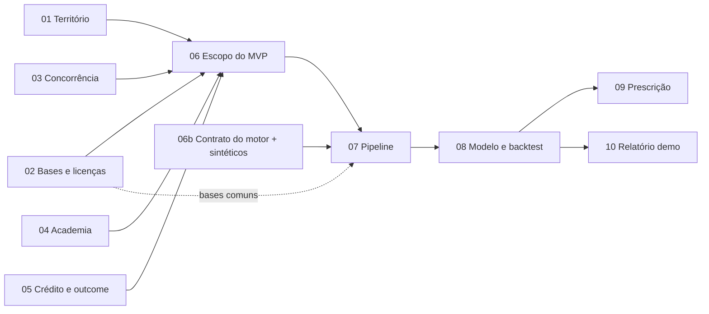

# Prompts das sessões

Cada arquivo é um prompt pronto: abra uma sessão nova no Claude Code na nuvem, cole o conteúdo **abaixo da linha `---`** e envie. Passo a passo em `docs/GUIA.md`.

## Ordem e paralelismo

| Onda | Sessões | Pode rodar em paralelo? | Pré-requisito |
|---|---|---|---|
| 1 | **01, 02, 03, 04, 05** | Sim, as 5 juntas: cada uma escreve em arquivos diferentes | PR desta sessão (00) mesclado |
| 2 | **06, 06b** | Sim: a 06 decide o escopo; a 06b escreve o contrato do motor, o stub e os dados sintéticos para o dev | PRs 01–05 mesclados |
| 3 | 07 → 08 | Sequenciais (a parte de bases comuns da 07 pode começar depois da 02) | 06 |
| 4 | **09, 10** | Sim | 08 |

## Prazo do crédito (vence em 2026-11-04)
- Meta: ondas 1 e 2 até 01/11; começar a 07 até 03/11.
- As sessões de pesquisa são as que mais se beneficiam do Opus. As de código (07–10) rodam bem no Sonnet (o opusplan já faz isso).

| # | Arquivo | Entregável principal |
|---|---|---|
| 01 | [01-diagnostico-territorial-da-regiao.md](01-diagnostico-territorial-da-regiao.md) | `docs/pesquisa/01-diagnostico-territorial.md` |
| 02 | [02-catalogo-bases-publicas-federais-e-mg-e-licencas.md](02-catalogo-bases-publicas-federais-e-mg-e-licencas.md) | `docs/pesquisa/02-catalogo-bases.md`, `licencas.md` |
| 03 | [03-concorrencia-e-lacunas.md](03-concorrencia-e-lacunas.md) | `docs/pesquisa/03-concorrencia-e-lacunas.md` |
| 04 | [04-estado-da-arte-academico.md](04-estado-da-arte-academico.md) | `docs/pesquisa/04-estado-da-arte.md` |
| 05 | [05-credito-rural-e-outcome-economico-na-regiao.md](05-credito-rural-e-outcome-economico-na-regiao.md) | `docs/pesquisa/05-credito-rural-e-outcome.md` |
| 06 | [06-debate-especialistas-escopo-mvp.md](06-debate-especialistas-escopo-mvp.md) | `docs/decisoes/escopo-mvp.md` |
| 06b | [06b-contrato-motor-e-dados-sinteticos.md](06b-contrato-motor-e-dados-sinteticos.md) | `docs/produto/contrato-motor-v0.md`, `src/agrorisk/motor/`, `tests/fixtures/sinteticos/` |
| 07 | [07-pipeline-dados-piloto.md](07-pipeline-dados-piloto.md) | `src/agrorisk/…`, `data/processed/painel_car_t0.parquet` (local) |
| 08 | [08-modelo-e-backtest.md](08-modelo-e-backtest.md) | `reports/backtest/`, `docs/modelo/model-card.md` |
| 09 | [09-priorizacao-sob-orcamento.md](09-priorizacao-sob-orcamento.md) | `reports/prescricao/` |
| 10 | [10-relatorio-demonstrativo.md](10-relatorio-demonstrativo.md) | `reports/demo-carteira/` |
